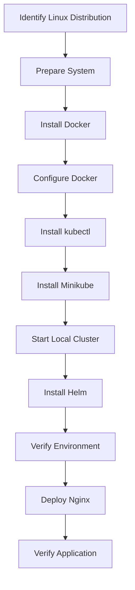

# Lab 01: SRE Lab Environment Setup

## Objective

Prepare a Linux machine as a local SRE lab environment by installing and configuring the tools required for containerization and Kubernetes-based exercises.

This lab covers installation procedures for the most common Linux distribution families:

- Debian-based distributions
- Fedora-based distributions
- Red Hat Enterprise Linux (RHEL)-based distributions
- Arch-based distributions
- openSUSE-based distributions

The environment will be verified by deploying a sample Nginx application to a local Kubernetes cluster.

---

## 1. Lab Overview

This lab covers the installation and verification of four essential tools:

| Tool | Purpose |
|---|---|
| Docker | Runs containers and provides the container driver for Minikube. |
| kubectl | Command-line tool for interacting with Kubernetes clusters. |
| Minikube | Creates and manages a local Kubernetes cluster. |
| Helm | Kubernetes package manager used to install and manage applications through charts. |

### 1.1 Supported Linux Distribution Families

Linux distributions use different package managers and package formats. The following table maps common distributions to their installation methods.

| Distribution Family | Examples | Package Manager | Package Format |
|---|---|---|---|
| Debian-based | Ubuntu, Debian, Linux Mint | APT | `.deb` |
| Fedora-based | Fedora | DNF | `.rpm` |
| RHEL-based | RHEL, CentOS Stream | DNF | `.rpm` |
| Arch-based | Arch Linux, Manjaro | Pacman | `.pkg.tar.zst` |
| openSUSE-based | openSUSE Leap, Tumbleweed | Zypper | `.rpm` |

**Important:** Commands for derivative distributions may need adjustments depending on their base distribution and release. Always check the official documentation for your specific release.

### 1.2 Identify Your Linux Distribution

Before installing anything, identify the distribution and system architecture.

```bash
cat /etc/os-release
```

Check the architecture:

```bash
uname -m
```

Common architecture values:

| Output | Architecture |
|---|---|
| `x86_64` | AMD64 |
| `aarch64` | ARM64 |

Check the available package manager:

```bash
command -v apt
command -v dnf
command -v yum
command -v pacman
command -v zypper
```

These commands help identify which package manager is available on the system.

### 1.3 Environment Workflow



---

## 2. Prepare the Linux System

Before installing the required tools, update the package index and install the basic utilities needed to download and verify packages.

### 2.1 Debian-based Distributions

For Ubuntu, Debian, and compatible distributions:

```bash
sudo apt update
sudo apt install -y curl wget ca-certificates gnupg lsb-release
```

### 2.2 Fedora and RHEL-based Distributions

For Fedora, RHEL, and CentOS Stream:

```bash
sudo dnf makecache
sudo dnf install -y curl wget ca-certificates gnupg
```

On older systems that use YUM:

```bash
sudo yum makecache
sudo yum install -y curl wget ca-certificates gnupg
```

### 2.3 Arch-based Distributions

For Arch Linux and compatible distributions:

```bash
sudo pacman -Syu
sudo pacman -S --needed curl wget ca-certificates gnupg
```

### 2.4 openSUSE-based Distributions

For openSUSE:

```bash
sudo zypper refresh
sudo zypper install -y curl wget ca-certificates gpg2
```

---

## 3. Install and Configure Docker

Docker Engine runs containers and provides the container runtime environment used by Minikube in this lab.

The installation procedure depends on the Linux distribution.

### 3.1 Debian-based Distributions

The following procedure uses Docker's official APT repository.

**Step 1: Remove conflicting packages**

```bash
sudo apt remove -y docker.io docker-doc docker-compose podman-docker containerd runc
```

**Step 2: Add Docker's official GPG key**

```bash
sudo install -m 0755 -d /etc/apt/keyrings

sudo curl -fsSL https://download.docker.com/linux/ubuntu/gpg \
  -o /etc/apt/keyrings/docker.asc

sudo chmod a+r /etc/apt/keyrings/docker.asc
```

For Debian, use the Debian repository key instead:

```bash
sudo curl -fsSL https://download.docker.com/linux/debian/gpg \
  -o /etc/apt/keyrings/docker.asc
```

**Step 3: Add the Docker repository**

For Ubuntu:

```bash
sudo tee /etc/apt/sources.list.d/docker.sources <<EOF
Types: deb
URIs: https://download.docker.com/linux/ubuntu
Suites: $(. /etc/os-release && echo "${UBUNTU_CODENAME:-$VERSION_CODENAME}")
Components: stable
Architectures: $(dpkg --print-architecture)
Signed-By: /etc/apt/keyrings/docker.asc
EOF
```

For Debian, use the Debian repository URL and Debian codename:

```bash
sudo tee /etc/apt/sources.list.d/docker.sources <<EOF
Types: deb
URIs: https://download.docker.com/linux/debian
Suites: $(. /etc/os-release && echo "$VERSION_CODENAME")
Components: stable
Architectures: $(dpkg --print-architecture)
Signed-By: /etc/apt/keyrings/docker.asc
EOF
```

**Step 4: Update the package index**

```bash
sudo apt update
```

**Step 5: Install Docker Engine and its plugins**

```bash
sudo apt install -y docker-ce docker-ce-cli containerd.io docker-buildx-plugin docker-compose-plugin
```

### 3.2 Fedora-based Distributions

The following procedure uses Docker's official DNF repository.

**Step 1: Remove conflicting packages**

```bash
sudo dnf remove -y docker docker-client docker-client-latest docker-common docker-latest docker-latest-logrotate docker-logrotate docker-engine
```

**Step 2: Add Docker's official repository**

```bash
sudo dnf install -y dnf-plugins-core

sudo dnf config-manager addrepo --from-repofile=https://download.docker.com/linux/fedora/docker-ce.repo
```

**Step 3: Install Docker Engine and its plugins**

```bash
sudo dnf install -y docker-ce docker-ce-cli containerd.io docker-buildx-plugin docker-compose-plugin
```

**Step 4: Start and enable Docker**

```bash
sudo systemctl enable --now docker
```

### 3.3 RHEL and CentOS Stream

Use Docker's RHEL or CentOS-specific repository.

For RHEL:

```bash
sudo dnf install -y dnf-plugins-core

sudo dnf config-manager --add-repo https://download.docker.com/linux/rhel/docker-ce.repo
```

For CentOS Stream:

```bash
sudo dnf install -y dnf-plugins-core

sudo dnf config-manager --add-repo https://download.docker.com/linux/centos/docker-ce.repo
```

Install Docker:

```bash
sudo dnf install -y docker-ce docker-ce-cli containerd.io docker-buildx-plugin docker-compose-plugin
```

Start and enable the service:

```bash
sudo systemctl enable --now docker
```

### 3.4 Arch-based Distributions

Arch Linux provides Docker through its distribution package repositories.

Update the system and install Docker:

```bash
sudo pacman -Syu
sudo pacman -S docker
```

Start and enable Docker:

```bash
sudo systemctl enable --now docker.service
```

For Manjaro, the corresponding Arch-based package installation method is generally used.

### 3.5 openSUSE-based Distributions

Docker Engine can be installed using the distribution's package repositories.

Refresh repositories:

```bash
sudo zypper refresh
```

Install Docker:

```bash
sudo zypper install docker
```

Start and enable the service:

```bash
sudo systemctl enable --now docker
```

**Note:** Docker's official Engine installation documentation does not list openSUSE among its directly tested platforms. The distribution package is maintained through the openSUSE packaging ecosystem, so package versions and configuration may differ from Docker's official packages.

### 3.6 Configure Docker Permissions

By default, Docker commands may require administrator privileges.

Add the current user to the Docker group:

```bash
sudo usermod -aG docker "$USER"
```

Apply the new group membership by logging out and logging back in, or by starting a new login session.

Alternatively, refresh the current shell session:

```bash
newgrp docker
```

**Security note:** Membership in the Docker group grants privileges that can effectively provide root-level control over the host. Only add trusted users to this group.

### 3.7 Verify Docker

Check the installed version:

```bash
docker --version
```

Check the Docker service:

```bash
sudo systemctl status docker
```

Run the Docker test container:

```bash
docker run hello-world
```

A successful test displays:

```text
Hello from Docker!
```

This verifies that Docker is installed and can run a container.

---

## 4. Install kubectl

`kubectl` is the command-line tool used to communicate with Kubernetes clusters.

It allows engineers to:

- Create and manage deployments.
- Inspect pods.
- Manage Kubernetes services.
- Check cluster resources.

The Kubernetes project provides Linux binaries that can be installed independently of the distribution's package manager.

### 4.1 Download kubectl

For AMD64 systems:

```bash
curl -LO "https://dl.k8s.io/release/$(curl -L -s https://dl.k8s.io/release/stable.txt)/bin/linux/amd64/kubectl"
```

For ARM64 systems:

```bash
curl -LO "https://dl.k8s.io/release/$(curl -L -s https://dl.k8s.io/release/stable.txt)/bin/linux/arm64/kubectl"
```

### 4.2 Install kubectl

```bash
sudo install -o root -g root -m 0755 kubectl /usr/local/bin/kubectl
```

Remove the downloaded file:

```bash
rm kubectl
```

### 4.3 Verify kubectl

```bash
kubectl version --client
```

At this stage, kubectl is installed but is not necessarily connected to a running Kubernetes cluster. Minikube will provide that cluster in the next step.

---

## 5. Install Minikube

Minikube provides a local Kubernetes cluster on a single machine.

It is useful for learning, testing, and practicing Kubernetes without requiring a cloud-based cluster.

### 5.1 Install Minikube

Minikube provides Linux binaries and packages for common architectures.

For AMD64:

```bash
curl -LO https://github.com/kubernetes/minikube/releases/latest/download/minikube-linux-amd64
```

For ARM64:

```bash
curl -LO https://github.com/kubernetes/minikube/releases/latest/download/minikube-linux-arm64
```

Install the binary:

For AMD64:

```bash
sudo install minikube-linux-amd64 /usr/local/bin/minikube
```

For ARM64:

```bash
sudo install minikube-linux-arm64 /usr/local/bin/minikube
```

Remove the downloaded file:

```bash
rm minikube-linux-*
```

This binary-based method works independently of APT, DNF, Pacman, or Zypper.

### 5.2 Start the Local Cluster

Start Minikube using Docker as its driver:

```bash
minikube start --driver=docker
```

Docker provides the container environment in which the local Minikube cluster runs.

### 5.3 Verify the Cluster

Check Minikube status:

```bash
minikube status
```

Check Kubernetes nodes:

```bash
kubectl get nodes
```

Expected result:

- A node named `minikube` should appear.
- Its status should be `Ready`.

This confirms that the local Kubernetes cluster is running and kubectl can communicate with it.

---

## 6. Install Helm

Helm is a package manager for Kubernetes.

It simplifies application installation, management, and upgrades through reusable packages called **charts**.

Helm provides Linux binary releases, allowing it to be installed on different distributions without relying on a specific package manager.

### 6.1 Install Helm Using the Official Installation Script

Download the installation script:

```bash
curl -fsSL -o get_helm.sh https://raw.githubusercontent.com/helm/helm/main/scripts/get-helm-3
```

Review the script before executing it:

```bash
less get_helm.sh
```

Make it executable:

```bash
chmod 700 get_helm.sh
```

Run the installer:

```bash
./get_helm.sh
```

Remove the script after installation:

```bash
rm get_helm.sh
```

### 6.2 Alternative: Install Helm Using Package Managers

For Debian-based distributions, use the official Helm installation instructions to configure the APT repository.

For Fedora, Helm is available through the distribution repository:

```bash
sudo dnf install helm
```

Package availability and versions may vary across distributions.

### 6.3 Verify Helm

```bash
helm version
```

Helm is now available for future Kubernetes deployment exercises.

---

## 7. Deploy a Test Application

After installing the tools, deploy a sample Nginx application to verify that the environment works end-to-end.

Nginx is a lightweight web server commonly used for container and Kubernetes testing.

### 7.1 Create an Nginx Deployment

```bash
kubectl create deployment nginx --image=nginx
```

This creates a Kubernetes Deployment named `nginx` using the Nginx container image.

### 7.2 Expose the Deployment

Expose the application through a NodePort service:

```bash
kubectl expose deployment nginx --type=NodePort --port=80
```

The Service provides a way to access the application through the Minikube environment.

### 7.3 Verify Kubernetes Resources

Check the deployment:

```bash
kubectl get deployments
```

Check the pods:

```bash
kubectl get pods
```

Check the services:

```bash
kubectl get services
```

The expected verification results are:

- The Nginx deployment appears in the deployment list.
- Its pod reaches the `Running` state.
- The service appears with the `NodePort` type.

To obtain the Minikube access URL:

```bash
minikube service nginx --url
```

Use the returned URL to access the test application.

---

## 8. Environment Verification Checklist

| Component | Verification | Expected Result |
|---|---|---|
| Linux Distribution | `cat /etc/os-release` | Distribution identified |
| Architecture | `uname -m` | Architecture identified |
| Docker | `docker --version` | Docker version displayed |
| Docker Service | `sudo systemctl status docker` | Active and running |
| Docker Test | `docker run hello-world` | Hello from Docker |
| kubectl | `kubectl version --client` | Client version displayed |
| Minikube | `minikube status` | Cluster components running |
| Kubernetes Node | `kubectl get nodes` | Minikube node is Ready |
| Helm | `helm version` | Helm version displayed |
| Nginx Deployment | `kubectl get deployments` | Nginx deployment listed |
| Nginx Pod | `kubectl get pods` | Pod reaches Running |
| Nginx Service | `kubectl get services` | NodePort service listed |

---

## 9. Troubleshooting Notes

### Docker Permission Denied

If Docker returns a permission error:

```bash
sudo usermod -aG docker "$USER"
newgrp docker
```

If the issue persists, log out and log back in.

### Docker Service Is Not Running

Check the service:

```bash
sudo systemctl status docker
```

Start it:

```bash
sudo systemctl start docker
```

### Minikube Cannot Start

Check Docker:

```bash
docker info
```

Check Minikube status:

```bash
minikube status
```

Try starting the cluster again:

```bash
minikube start --driver=docker
```

### Kubernetes Node Is Not Ready

Check the cluster:

```bash
kubectl get nodes
```

Inspect the node:

```bash
kubectl describe node minikube
```

Check Minikube logs:

```bash
minikube logs
```

---

## 10. Lab Outcome

The Linux machine is prepared with the main tools required for the SRE lab environment:

- Docker installed and configured.
- kubectl installed and ready to communicate with Kubernetes.
- Minikube running a local Kubernetes cluster using Docker as its driver.
- Helm installed and ready for Kubernetes application management.
- Nginx successfully deployed and exposed through a NodePort service.

This environment provides the foundation for future exercises involving:

- Containerized applications.
- Kubernetes workloads.
- Service exposure.
- Helm-based deployments.
- Monitoring and observability.
- Reliability testing.

**Key Takeaway:** A working SRE lab environment should not only have its tools installed; it should also be verified through a real application deployment.
