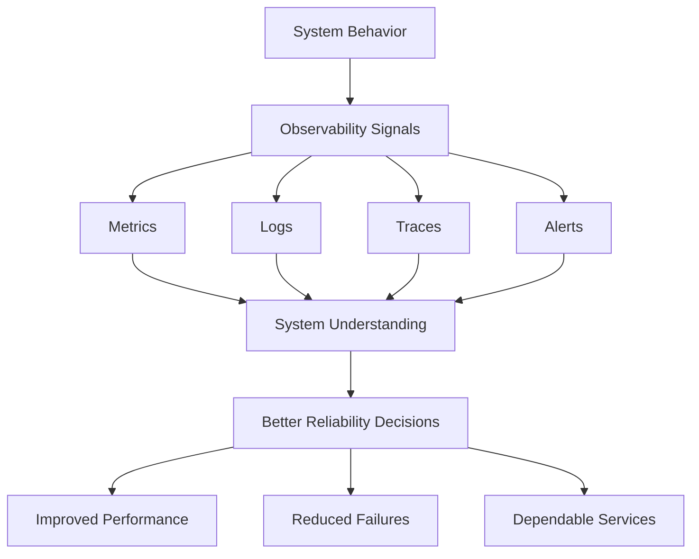
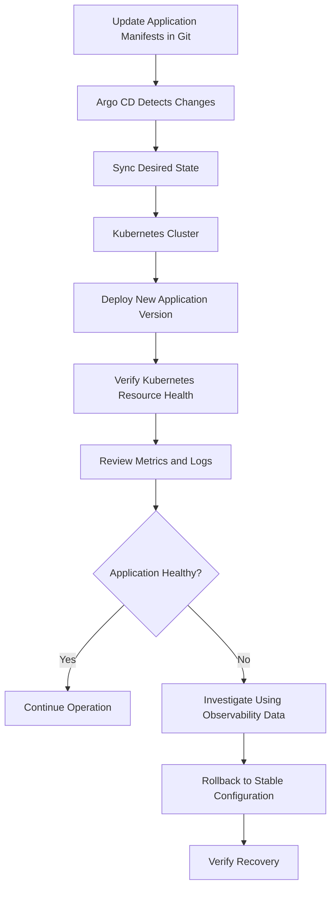

# Observability Fundamentals for Reliable Systems

## Overview

Observability helps engineering teams understand system behavior by providing visibility into what is happening inside their systems.

It transforms raw system data into actionable understanding, allowing SRE teams to detect issues early, investigate root causes, and make informed reliability decisions.

The core idea is:

> You can't fix what you can't see.

## 1. What Is Observability?

Observability is the ability to understand a system's internal behavior through the data it produces.

It provides visibility into system activity across services and helps teams understand how different components behave and interact.

For example, an application dashboard may display:

- Requests per second.
- Error rate.
- Latency.
- Availability.
- CPU and memory utilization.
- Application logs.
- Distributed traces across services.

Together, these signals help teams understand the overall health and behavior of a system.

### Four Dimensions of Observability

| Dimension | Key Question |
|---|---|
| Performance | How fast is the system? |
| Failures | What is breaking? |
| Dependencies | How are services affecting each other? |
| User Impact | Are real users experiencing problems? |

Without observability, teams may react only to visible symptoms. With observability, they gain deeper insight into system behavior and can identify problems before their impact escalates.

## 2. Why Observability Matters

Observability processes system signals and turns them into three important capabilities.

### 2.1 Detect Issues Early

Observability helps teams identify anomalies and emerging problems before they cause greater impact.

This allows engineers to investigate and respond proactively instead of waiting for users to report issues.

### 2.2 Understand Root Causes

When a failure occurs, observability provides context to investigate:

- Which component failed?
- When did the issue happen?
- Under what conditions did it occur?
- How did the failure affect other services?

The goal is to understand why something failed, not just identify what failed.

### 2.3 Respond with Confidence

Reliable and clear system data helps engineers make faster, evidence-based decisions during incidents.

It reduces guesswork and supports more effective incident response.

**Key Idea:** Observability turns signals into understanding.

## 3. The Four Observability Signals

Observability relies on four complementary signals: metrics, logs, traces, and alerts.

No single signal provides the complete picture of system behavior.

### 3.1 Metrics

Metrics are numerical measurements that describe system behavior and performance over time.

Examples include:

- CPU utilization.
- Memory utilization.
- Requests per second.
- Error rate.
- Request latency.
- Service availability.

Metrics help teams identify trends, anomalies, and performance degradation.

**Main purpose:** Show what is happening in the system.

### 3.2 Logs

Logs are timestamped records of events generated by applications and infrastructure.

They provide details about what happened during system execution.

Logs help engineers investigate errors and understand the sequence of events surrounding an issue.

**Main purpose:** Explain what happened.

### 3.3 Traces

Traces represent the journey of a request as it travels across different services in a distributed system.

For example, a request may pass through:

1. User Service.
2. Order Service.
3. Payment Service.

Tracing helps engineers understand the request flow, identify dependencies, and locate where time is spent or failures occur.

**Main purpose:** Show where a request traveled and where delays or failures occurred.

### 3.4 Alerts

Alerts are notifications triggered when system signals cross defined thresholds or deviate from expected behavior.

They help ensure that the appropriate people are informed when intervention may be required.

**Main purpose:** Notify teams when action is needed.

### Signal Comparison

| Signal | Main Question | Example |
|---|---|---|
| Metrics | What is happening? | CPU usage increased |
| Logs | What happened? | Database connection failed |
| Traces | Where did it happen? | Payment Service caused a delay |
| Alerts | When should we act? | High error rate notification |

## 4. Observability and System Reliability

The value of observability is not limited to collecting data or displaying dashboards. Its real value comes from improving the decisions teams make.

### Without Observability

Teams may face:

- Disconnected dashboards.
- Scattered data that is difficult to correlate.
- Manual checks that do not scale.
- Unclear user impact during failures.

As a result, engineers may spend more time understanding what is happening than resolving the actual issue.

### With Observability

Observability provides unified visibility into metrics, logs, traces, and alerts.

This supports:

| Outcome | How Observability Helps |
|---|---|
| Better Reliability Decisions | Decisions are based on real system data rather than assumptions. |
| Improved Performance | Bottlenecks become visible before they develop into outages. |
| Reduced Failures | Issues can be detected and addressed earlier. |
| Dependable Services | Teams can maintain reliability continuously instead of only reacting to incidents. |

## 5. The Observability-to-Reliability Flow

The overall logic is:

**Clear Visibility → Smarter Decisions → Reliable Systems**

## 6. Connecting Observability with GitOps-Based Deployment

Modern applications are often deployed across containers, Kubernetes clusters, and multiple environments.

A successful deployment does not automatically mean that the application is healthy or performing as expected.

SRE teams need both deployment configuration control and visibility into the actual behavior of deployed services.

This is where GitOps and Observability work together.

### 6.1 Why Observability Matters After Deployment

Deployment is only the beginning of service operation.

After an application is deployed, teams need to verify that it is:

- Healthy.
- Reachable.
- Performing as expected.
- Providing a reliable user experience.

A Kubernetes Pod may be in the `Running` state while users are still experiencing slow responses, failed requests, or broken application paths.

Therefore, checking Kubernetes resource status alone is not sufficient to understand the application's actual health.

Observability provides additional visibility through metrics, logs, and traces.

It helps teams:

| Capability | Purpose |
|---|---|
| Verify Service Health | Confirm that the application responds correctly after deployment. |
| Detect Failures Early | Identify problems before they become major incidents. |
| Understand User Impact | Determine whether errors or latency affect users. |
| Faster Troubleshooting | Use logs and traces to narrow down where problems occur. |

### 6.2 What Is GitOps?

GitOps is an approach to managing application deployment and infrastructure configuration where Git acts as the **Source of Truth**.

Instead of manually changing the Kubernetes cluster, teams update configuration files and Kubernetes manifests stored in a Git repository.

A GitOps tool such as Argo CD compares two states:

- **Desired State:** The configuration defined in Git.
- **Live State:** The actual configuration running in the Kubernetes cluster.

When differences are detected, the GitOps tool can identify the drift and help synchronize the cluster with the desired configuration.

### GitOps Benefits

| Benefit | Description |
|---|---|
| Consistency | Configuration changes follow a controlled and repeatable process. |
| Traceability | Changes can be reviewed and tracked through Git history. |
| Recovery | Previous configurations can be restored through Git-based rollback workflows. |

GitOps reduces the risk of undocumented or unapproved manual changes to the cluster.

### 6.3 How Observability and GitOps Work Together

GitOps and Observability solve different but connected problems.

| GitOps | Observability |
|---|---|
| Is the cluster running the configuration defined in Git? | Is the application actually healthy and working well for users? |
| Manages desired and live configuration states. | Provides visibility into application behavior. |
| Detects configuration differences. | Detects performance problems and failures. |
| Supports synchronization and configuration recovery. | Supports investigation and troubleshooting. |

An application can be successfully synchronized by Argo CD without necessarily meeting its reliability expectations.

For example, Argo CD may report that an application is synced, but users may still experience a high error rate or increased latency.

Observability helps identify these problems after deployment.

### 6.4 Example: A GitOps-Based Deployment Workflow

Consider a team deploying a new version of an application to Kubernetes.

1. The team updates the application manifests in Git.
2. Argo CD detects the configuration change.
3. Argo CD synchronizes the desired configuration with the Kubernetes cluster.
4. The new application version is deployed.
5. The team checks Kubernetes resource health.
6. SRE engineers review request rate, latency, error rate, and application logs.
7. If the new version causes errors, the team can use GitOps to roll back to a stable configuration.
8. Observability data helps engineers investigate what went wrong.

### Deployment and Observability Workflow

This workflow connects configuration management, deployment verification, observability, and recovery.

### 6.5 Applying This in Real SRE Workflows

Deployment and monitoring should not be treated as separate activities.

A reliable deployment workflow should include:

- Updating application manifests in Git.
- Synchronizing changes through Argo CD.
- Checking application health.
- Reviewing metrics and logs.
- Taking corrective action when the service becomes degraded.

A deployment should not be considered successful based only on the deployment process completing successfully.

The application must also operate within acceptable health conditions.

## 7. Key Takeaways

- Observability provides visibility into internal system behavior.
- It helps teams understand performance, failures, dependencies, and user impact.
- Metrics, logs, traces, and alerts are complementary signals.
- Observability supports early issue detection, root-cause investigation, and confident response.
- GitOps uses Git as the source of truth for application configuration.
- Argo CD compares desired configuration with the live Kubernetes state.
- GitOps improves deployment consistency, traceability, and recovery.
- GitOps confirms configuration synchronization, while Observability helps verify actual application behavior.
- Combining both practices supports safer deployments, faster troubleshooting, and stronger operational confidence.

**Final Principle:**

A successful deployment is not just an application running in Kubernetes. It is an application deployed with the expected configuration and operating reliably for its users.
