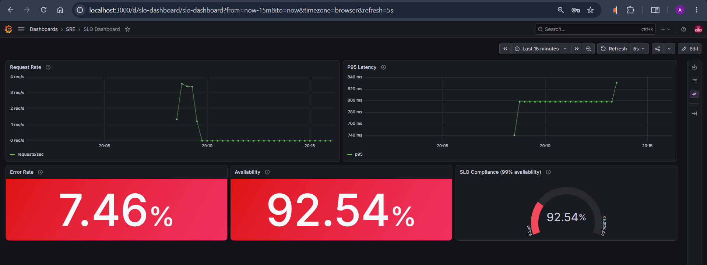

# Lab: SLO Dashboard in Grafana

Build an SLO-driven Grafana dashboard on top of Prometheus metrics exposed by a sample Flask app.

## Objectives

- Expose request count and latency metrics from a Flask app
- Configure Prometheus to scrape the app
- Build Grafana panels for request rate, P95 latency, error rate, availability and SLO compliance

## Architecture

```
  traffic script --> slo-demo-app:8000 --/metrics--> prometheus:9090 --> grafana:3000
                     (Flask + prom client)            (scrape every 5s)   (SLO dashboard)
```



## Structure

| Path                        | Purpose                                         |
|-----------------------------|-------------------------------------------------|
| `docker-compose.yml`        | App, Prometheus and Grafana on one network      |
| `app/`                      | Flask app, requirements and Dockerfile          |
| `prometheus/prometheus.yml` | Scrape jobs (prometheus, slo-demo-app)          |
| `grafana/provisioning/`     | Auto-provisioned datasource and dashboard loader|
| `grafana/dashboards/`       | Dashboard JSON `slo-dashboard.json`             |
| `scripts/`                  | Traffic generator                               |
| `run.sh`                    | One-command runner                              |

## Prerequisites

- Docker with the Compose plugin
- Ports 3000, 8000 and 9090 free (stop containers from the earlier lab first)

## Quick start

```bash
bash run.sh
```

This builds the app, starts the stack, waits until everything is healthy, confirms the Prometheus target is up, and sends 200 requests.

| Service    | URL                                      |
|------------|------------------------------------------|
| Dashboard  | http://localhost:3000/d/slo-dashboard    |
| Prometheus | http://localhost:9090/targets            |
| App        | http://localhost:8000/orders             |
| Metrics    | http://localhost:8000/metrics            |

Grafana login: `admin` / `admin`

## Commands

```bash
bash run.sh              # build, start, wait, generate traffic
bash run.sh traffic 300  # send 300 more requests
bash run.sh status       # list containers
bash run.sh down         # stop and remove everything
```

## Metrics

| Metric                          | Type      | Labels                    |
|---------------------------------|-----------|---------------------------|
| `http_requests_total`           | Counter   | method, endpoint, status  |
| `http_request_duration_seconds` | Histogram | endpoint                  |

## Dashboard panels

| Panel          | Type       | PromQL                                                                                              |
|----------------|------------|-----------------------------------------------------------------------------------------------------|
| Request Rate   | Time series| `sum(rate(http_requests_total[1m]))`                                                                |
| P95 Latency    | Time series| `histogram_quantile(0.95, sum(rate(http_request_duration_seconds_bucket[5m])) by (le))`             |
| Error Rate     | Stat       | `100 * (sum(rate(http_requests_total{status=~"5.."}[5m])) or vector(0)) / sum(rate(http_requests_total[5m]))` |
| Availability   | Stat       | `100 * (sum(rate(http_requests_total{status!~"5.."}[5m])) or vector(0)) / sum(rate(http_requests_total[5m]))` |
| SLO Compliance | Gauge      | Same query as Availability, green at or above 99%                                                   |

## Verification

1. `http://localhost:9090/targets` shows `slo-demo-app` as UP
2. Query `up` in Prometheus returns 1 for both `prometheus` and `slo-demo-app`
3. `curl localhost:8000/metrics` returns `http_requests_total` and `http_request_duration_seconds_bucket`
4. The dashboard shows data on all 5 panels after traffic is generated

## SLO notes

- SLI: availability = successful requests / total requests
- SLO: 99% availability
- Error budget: 1% of requests may fail
- The app fails 5% of requests by default, so the gauge turns red. This demonstrates an SLO breach.
- To meet the SLO, set `ERROR_RATE=0.005` in `docker-compose.yml`, then run `docker compose up -d` and generate traffic again.

## Troubleshooting

| Problem                          | Fix                                                                          |
|----------------------------------|------------------------------------------------------------------------------|
| Port already in use              | Stop old Prometheus/Grafana containers: `docker stop prometheus grafana`    |
| Panels show "No data"            | Run `bash run.sh traffic 200`; rate queries use a 5m window                  |
| Target is DOWN                   | Check `docker compose logs slo-demo-app` and that all containers share the `monitoring` network |
| Script errors with `\r`          | Convert line endings: `sed -i 's/\r$//' run.sh scripts/*.sh`                 |

## Cleanup

```bash
bash run.sh down
```