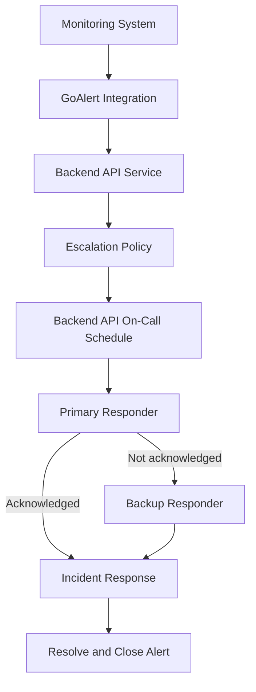

# Lab: Managing On-Call Escalations with GoAlert

## Objective

Set up a basic on-call incident response workflow using GoAlert.

This lab demonstrates how to:

- Run GoAlert locally using Docker.
- Create primary and backup responders.
- Configure an on-call schedule.
- Define an escalation policy.
- Connect a service to an escalation policy.
- Create an alert integration.
- Simulate, acknowledge, and close an incident.

## 1. Lab Overview

GoAlert is an incident management and on-call scheduling tool. It helps teams route alerts to the responsible responders and escalate unacknowledged alerts according to a predefined policy.

The workflow in this lab is:



## 2. Prerequisites

- Ubuntu environment.
- Docker installed and running.
- Access to a web browser.
- Basic understanding of alerts and incident response.

Verify Docker:

```bash
docker --version
docker info
```

The Docker daemon must be running before continuing.

## 3. Start GoAlert

GoAlert provides a demo Docker image for local evaluation.

Start the container:

```bash
docker run -d \
  --name goalert-demo \
  -p 8081:8081 \
  goalert/demo
```

The command:

- `-d` runs the container in the background.
- `--name` assigns a recognizable container name.
- `-p 8081:8081` maps the host port to the container port.
- `goalert/demo` is the GoAlert demo image.

If port `8081` is already in use, use an alternative host port:

```bash
docker run -d \
  --name goalert-demo \
  -p 8082:8081 \
  goalert/demo
```

Verify the container:

```bash
docker ps
docker logs goalert-demo
```

Open GoAlert in your browser:

- Default port: `http://localhost:8081`
- Alternative port: `http://localhost:8082`

For the demo image, the default login credentials are:

| Field | Value |
|---|---|
| Username | `admin` |
| Password | `admin123` |

These credentials are for the local demo environment only. Do not use demo credentials in a production deployment.

## 4. Create Responder Users

Create two sample users in GoAlert.

### Primary Responder

The primary responder is the first person responsible for receiving and handling an alert.

Example:

- Name: `Primary Responder`
- Email: `primary@example.com`

### Backup Responder

The backup responder receives the alert if the primary responder does not acknowledge it within the escalation window.

Example:

- Name: `Backup Responder`
- Email: `backup@example.com`

The email addresses are demonstration values. They do not need to receive real notifications for this lab.

**Expected result:** Two responder accounts are available in GoAlert.

## 5. Create an On-Call Schedule

Create a schedule with the following configuration:

| Setting | Value |
|---|---|
| Schedule Name | Backend API On-Call |
| Time Zone | Your local time zone |
| Assigned User | Primary Responder |

Add the primary responder to the schedule and configure the assignment so that this responder is currently on-call.

Save the schedule and verify that the primary responder appears as the current on-call user.

### Why is this important?

An on-call schedule establishes who currently owns incident response.

Instead of relying on informal communication, the team can identify the responsible responder at any given time.

## 6. Create an Escalation Policy

Create an escalation policy:

`Backend API Escalation Policy`

Configure the escalation steps:

| Step | Target | Timing |
|---|---|---|
| 1 | Backend API On-Call schedule | Immediately |
| 2 | Backup Responder | After a delay |

Use the smallest available delay for the second step to make the escalation behavior easier to observe.

Save the policy.

### Expected behavior

1. A new alert is routed to the current on-call responder.
2. If the alert is not acknowledged within the configured time, GoAlert proceeds to the next escalation step.
3. The backup responder becomes the next escalation contact.

Acknowledging an alert indicates that a responder has taken ownership. It does not necessarily mean the underlying incident has been resolved.

## 7. Create a Service

Create a service with the following details:

| Setting | Value |
|---|---|
| Service Name | Backend API Service |
| Escalation Policy | Backend API Escalation Policy |

Save the service.

### Why is this important?

A service represents the system or component affected by an incident.

Connecting the service to an escalation policy tells GoAlert where alerts for that service should be routed.

## 8. Create an Alert Integration

Open `Backend API Service` and create a new integration.

Use a generic API integration for the demonstration.

The integration allows an external monitoring system, script, or tool to send alerts to GoAlert.

After creating it:

1. Copy the generated integration key or webhook URL.
2. Keep the integration details available for the next step.
3. Treat the generated key as a secret. Do not commit it to Git or include it in screenshots.

## 9. Simulate an Incident Alert

Use the integration details to send a test alert.

Use the following alert information:

| Field | Value |
|---|---|
| Summary | High error rate detected on Backend API |
| Details | API error rate crossed the SLO threshold during the demonstration. |

Use the request format or example provided by the integration configuration in GoAlert. The exact endpoint and payload depend on the selected integration type.

After sending the alert, open GoAlert and verify that:

- A new alert has been created.
- The alert is associated with `Backend API Service`.
- The alert enters the configured escalation workflow.
- The primary responder is the first responder.

## 10. Test Acknowledgment and Escalation

Perform two scenarios.

### Scenario A: Primary Responder Acknowledges

1. Generate a new alert.
2. Open the alert in GoAlert.
3. Acknowledge it using the primary responder.
4. Verify that the alert is acknowledged and has an assigned responder.

**Expected result:** The primary responder takes ownership of the alert.

### Scenario B: Primary Responder Does Not Acknowledge

1. Generate another alert.
2. Do not acknowledge it as the primary responder.
3. Wait for the configured escalation delay.
4. Verify that the next escalation step is triggered.

**Expected result:** GoAlert proceeds to the backup responder according to the escalation policy.

The actual delivery of email, SMS, or voice notifications depends on the notification configuration. This lab focuses on the routing and escalation workflow.

## 11. Resolve and Close the Alert

After reviewing the alert:

1. Investigate the simulated issue.
2. Apply or describe the appropriate mitigation.
3. Verify that the service is healthy again.
4. Close the alert in GoAlert.

Remember:

- **Acknowledge** means someone has taken ownership.
- **Resolve** means the underlying issue has been addressed.
- **Close** records that the alert is no longer active.

## 12. Verification Checklist

- [ ] GoAlert container is running.
- [ ] GoAlert interface is accessible.
- [ ] Primary responder has been created.
- [ ] Backup responder has been created.
- [ ] Backend API On-Call schedule is configured.
- [ ] Primary responder is currently on-call.
- [ ] Escalation policy contains both escalation steps.
- [ ] Backend API Service is connected to the policy.
- [ ] Generic API integration has been created.
- [ ] Test alert has been received.
- [ ] Alert acknowledgment has been tested.
- [ ] Escalation behavior has been reviewed.
- [ ] Alert has been closed after resolution.

## 13. Cleanup

Stop and remove the demo container when the lab is complete:

```bash
docker stop goalert-demo
docker rm goalert-demo
```

If you used a different container name, replace `goalert-demo` accordingly.

## Key Takeaways

- On-call schedules define who is responsible for responding to incidents.
- Escalation policies determine what happens when an alert is not acknowledged.
- Services connect alerts to the correct escalation policy.
- Integrations allow monitoring systems to send alerts into GoAlert.
- Acknowledgment establishes ownership, while resolution addresses the underlying issue.
- Automated escalation reduces the risk of critical alerts being missed.
