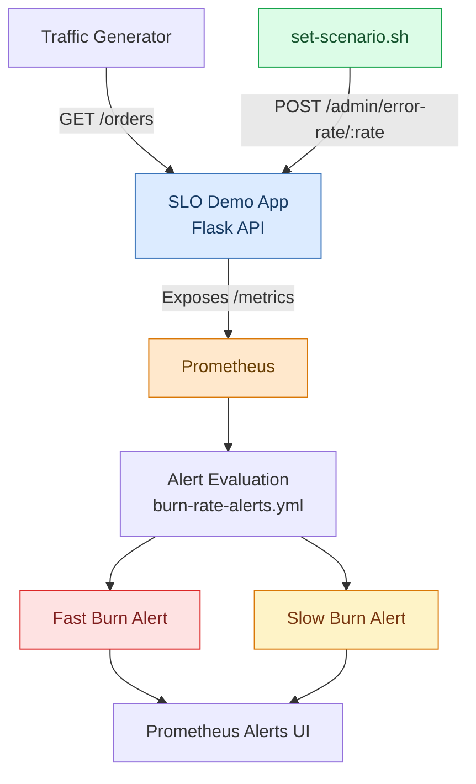
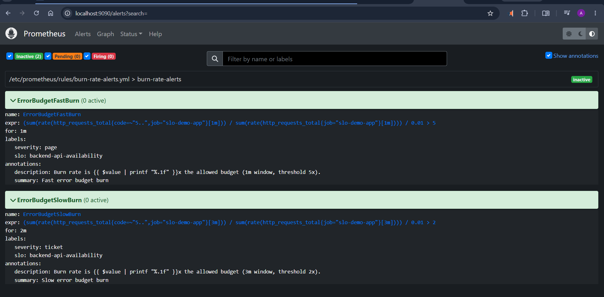
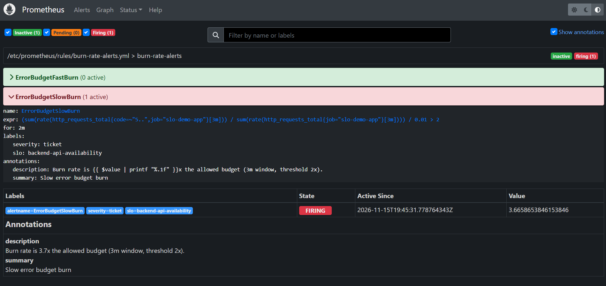
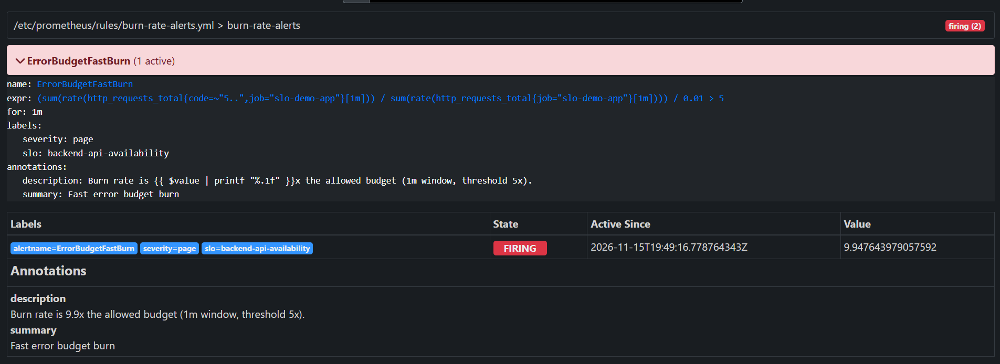

# Burn Rate Alerts for a 99% Availability SLO

Hands-on lab: create fast burn and slow burn alerts in Prometheus for a 99% availability SLO, then trigger them with controlled error rates.

Part of: `module-03-sre-operations-and-toil / part-02-reliability-reviews-and-release-decisions`

## Objectives

- Write Prometheus alerting rules based on burn rate
- Understand fast burn vs slow burn (window, threshold, `for`)
- Observe alert states: Inactive, Pending, Firing
- Verify the burn rate manually with a PromQL query

## Architecture



| Service | Role | Port |
|---|---|---|
| `slo-demo-app` | Flask API exposing `http_requests_total{code}` with adjustable error rate | 8000 |
| `traffic` | Sends about 10 requests/second to `/orders` | - |
| `prometheus` | Scrapes metrics, evaluates alert rules | 9090 |

## Structure

```text
burn-rate-alerts-lab/
├── docker-compose.yml
├── app/                          # demo app + traffic generator
├── prometheus/
│   ├── prometheus.yml
│   └── rules/burn-rate-alerts.yml
├── scripts/set-scenario.sh       # normal | degraded | incident
└── docs/screenshots/
```

## Burn rate

For a 99% SLO the error budget is 1% (`0.01`).

```text
burn rate = (errors / total requests) / 0.01
```

Burn rate of 1 consumes the budget exactly over the SLO window. Above 1 means the SLO will be breached if the rate continues.

## Alert definitions

| Alert | Rate window | Threshold | `for` | Severity | Catches |
|---|---|---|---|---|---|
| `ErrorBudgetFastBurn` | 1m | burn rate > 5 | 1m | page | Sudden incidents (bad deploy, dependency outage) |
| `ErrorBudgetSlowBurn` | 3m | burn rate > 2 | 2m | ticket | Gradual, sustained degradation |

Windows are short to keep the lab fast. Production alerts typically use windows of 5m to 6h with multi-window checks.

## Prerequisites

| Tool | Check |
|---|---|
| Docker Engine / Desktop | `docker --version` |
| Docker Compose v2 | `docker compose version` |

Ports 8000 and 9090 must be free. Stop other labs first (`docker compose down -v`).

## Quick start

```bash
cd module-03-sre-operations-and-toil/part-02-reliability-reviews-and-release-decisions/burn-rate-alerts-lab

docker compose up -d --build
docker compose ps
docker compose exec prometheus promtool check rules /etc/prometheus/rules/burn-rate-alerts.yml
```

| URL | What |
|---|---|
| http://localhost:9090/rules | Loaded alert rules |
| http://localhost:9090/alerts | Alert states |
| http://localhost:9090/graph | Manual queries |



*Figure 1. Prometheus Rules page showing both `ErrorBudgetFastBurn` and `ErrorBudgetSlowBurn` loaded from `burn-rate-alerts.yml`.*

## Manual burn rate query

```promql
(sum(rate(http_requests_total{code=~"5.."}[1m])) / sum(rate(http_requests_total[1m]))) / 0.01
```

If the result is above 5, the fast burn condition is true.

## Scenarios

| Scenario | Command | Error rate | Expected burn rate | Fast | Slow |
|---|---|---|---|---|---|
| Normal | `./scripts/set-scenario.sh normal` | 0.2% | about 0.2 | Inactive | Inactive |
| Degraded | `./scripts/set-scenario.sh degraded` | 3% | about 3 | Inactive | Firing |
| Incident | `./scripts/set-scenario.sh incident` | 10% | about 10 | Firing | Firing |

### Degraded: slow burn only

Wait about 5 minutes.



*Figure 2. Error rate of 3% gives a burn rate near 3. It stays under the fast threshold (5) but above the slow threshold (2), so only `ErrorBudgetSlowBurn` fires.*

### Incident: fast and slow burn

Wait about 3 minutes.



*Figure 3. Error rate of 10% gives a burn rate near 10. Both thresholds are exceeded, so `ErrorBudgetFastBurn` and `ErrorBudgetSlowBurn` are firing.*

### Recovery

```bash
./scripts/set-scenario.sh normal
```

Alerts return to Inactive once the rate windows contain only healthy traffic.

## Alert states

| State | Meaning |
|---|---|
| Inactive | Condition is false |
| Pending | Condition is true but not yet for the full `for` duration |
| Firing | Condition stayed true for the `for` duration |

## Design notes

- Series for `code="200"` and `code="500"` are created at startup so `rate()` has data from the first scrape.
- `scrape_interval` is 5s and `evaluation_interval` is 15s for fast feedback.
- Rules are mounted read-only. After editing, reload with `curl -X POST localhost:9090/-/reload`.
- No Alertmanager: alerts are visible in the Prometheus UI only, which matches the scope of the lab.

## Troubleshooting

| Symptom | Fix |
|---|---|
| Rules page is empty | `docker compose exec prometheus promtool check rules /etc/prometheus/rules/burn-rate-alerts.yml` and check the mount path |
| Query returns no data | Check Status > Targets and that `traffic` is running |
| Alert stays Inactive | Confirm the scenario with `curl -s localhost:8000/admin/error-rate` and wait for the rate window to fill |
| Port already in use | Stop the previous lab: `docker compose down -v` in its folder |
| Edited rules not applied | `curl -X POST localhost:9090/-/reload` |

## Cleanup

```bash
docker compose down -v
```

## Extension ideas

- Add Alertmanager and route `page` and `ticket` severities to different receivers
- Add multi-window multi-burn-rate alerts (for example 5m and 1h together)
- Move the burn rate expression into a recording rule
- Alert on a 99.9% SLO with a 30d window