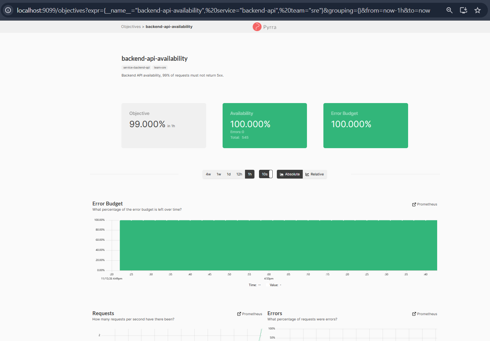
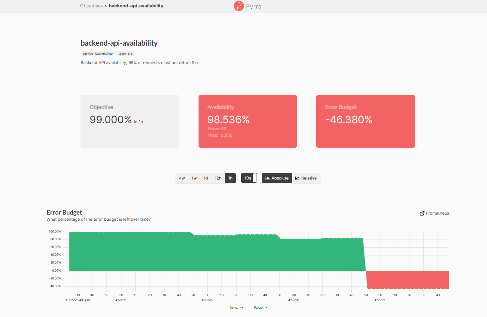
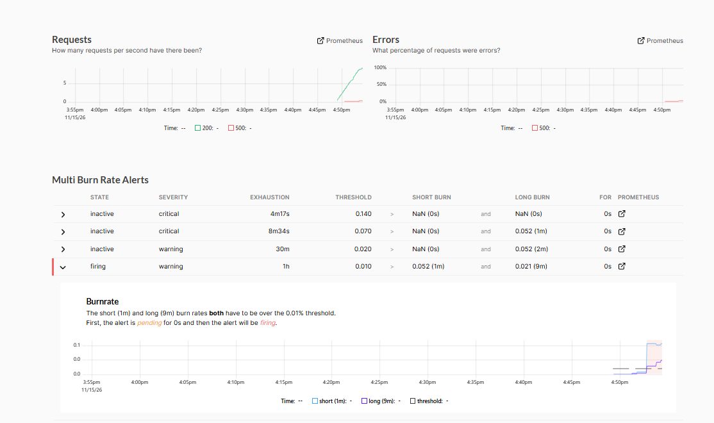

# SLO and Error Budget Tracking with Pyrra (Docker)

Hands-on lab: define a 99% availability SLO for a backend API, connect Pyrra to Prometheus, and observe SLO compliance, error budget, and burn rate in two scenarios: SLO met and SLO violated.

Part of: `module-03-sre-operations-and-toil / part-02-reliability-reviews-and-release-decisions`

## Objectives

- Define an SLO as a YAML file (ratio indicator, 99% target, 1h window)
- Let Pyrra generate Prometheus recording and alerting rules from it
- Generate traffic with a controllable error rate
- Compare a healthy service against a violating one in the Pyrra UI

## Architecture

```
traffic ──GET /orders──> slo-demo-app ──/metrics──> Prometheus
                                                      │  ▲
                              generated rules (files) │  │ queries
                                                      ▼  │
                       pyrra/slos/*.yaml ──> pyrra-filesystem ──> pyrra-ui :9099
```

| Service | Role | Port |
|---|---|---|
| `slo-demo-app` | Flask API exposing `http_requests_total{code}` | 8000 |
| `traffic` | Sends about 10 requests/second to `/orders` | - |
| `prometheus` | Scrapes metrics, loads Pyrra rules | 9090 |
| `pyrra-filesystem` | Reads SLO files, writes Prometheus rules | 9444 (internal) |
| `pyrra-ui` | SLO dashboard and API | 9099 |

## Structure

```
pyrra-slo-lab/
├── docker-compose.yml
├── app/                      # demo app + traffic generator
├── prometheus/
│   ├── prometheus.yml
│   └── rules/                # generated by Pyrra (git-ignored)
├── pyrra/slos/
│   └── backend-api-availability.yaml
├── scripts/set-scenario.sh   # switch error rate: meet | violate
└── docs/screenshots/
```

## SLO definition

| Field | Value |
|---|---|
| Name | `backend-api-availability` |
| Team / Service | `sre` / `backend-api` |
| Target | 99% |
| Window | 1h |
| Errors | `http_requests_total{job="slo-demo-app",code=~"5.."}` |
| Total | `http_requests_total{job="slo-demo-app"}` |

Error budget = 1% of requests in the window. At about 10 req/s that is roughly 36,000 requests/hour, so about 360 failed requests.

## Prerequisites

| Tool | Check |
|---|---|
| Docker Engine / Desktop | `docker --version` |
| Docker Compose v2 | `docker compose version` |

## Quick start

```bash
cd module-03-sre-operations-and-toil/part-02-reliability-reviews-and-release-decisions/pyrra-slo-lab

docker compose up -d --build
docker compose ps
ls prometheus/rules
```

Open:

| URL | What |
|---|---|
| http://localhost:9099 | Pyrra UI |
| http://localhost:9090 | Prometheus |
| http://localhost:8000/metrics | App metrics |

## Verify the pipeline

```bash
docker compose logs pyrra-filesystem | tail -20
curl -s localhost:8000/metrics | grep http_requests_total
```

Prometheus queries:

| Purpose | Query |
|---|---|
| Total requests | `sum(http_requests_total)` |
| Failed requests | `sum(http_requests_total{code=~"5.."})` |
| Request rate | `sum(rate(http_requests_total[1m]))` |

Status > Rules in Prometheus should list the rules generated by Pyrra.

## Scenario A: SLO met

```bash
./scripts/set-scenario.sh meet     # error rate 0.2%
```

Wait about 10 minutes, then open the SLO details page.



*Figure 1. `backend-api-availability` with a 0.2% error rate. Availability stays above the 99% target, the error budget remaining is positive, and the burn rate stays below 1, so the SLO is compliant.*

## Scenario B: SLO violated

```bash
./scripts/set-scenario.sh violate  # error rate 5%
```

Wait about 10 to 15 minutes, then open the SLO details page.




*Figure 2. Same SLO with a 5% error rate. Availability drops below the 99% target, the error budget is exhausted (negative remaining), and the burn rate is far above 1, so the SLO is violated.*

## Comparison

| Metric | Scenario A (meet) | Scenario B (violate) |
|---|---|---|
| Error rate injected | 0.2% | 5% |
| Availability vs 99% target | Above | Below |
| Error budget remaining | Positive | Exhausted |
| Burn rate | Below 1 | Well above 1 |
| Compliance | Met | Violated |

Burn rate of 1 means the budget would be consumed exactly over the full window. Above 1 means the SLO will be breached if the current failure rate continues.

## Design notes

- Series for `code="200"` and `code="500"` are created at startup so `rate()` has data from the first scrape.
- `scrape_interval` is 5s so the UI reacts quickly.
- The 1h window makes the lab fast, but a production SLO usually uses 28 or 30 days.
- `pyrra-filesystem` runs as root so it can write generated rules into the bind-mounted folder.
- Pyrra is pinned to `v0.9.0`. This version is known to avoid UI issues seen with other tags.

## Troubleshooting

| Symptom | Fix |
|---|---|
| UI is empty right after start | Wait 2 to 3 minutes for the first rule evaluations |
| `prometheus/rules` is empty | `docker compose logs pyrra-filesystem` and check the SLO file path and YAML |
| No data in the SLO page | Check Prometheus targets (Status > Targets) and that `traffic` is running |
| New rules not loaded | `curl -X POST localhost:9090/-/reload` |
| UI errors or blank page | Confirm both Pyrra containers use `v0.9.0` |
| Scenario B looks mixed with A | Reset with `docker compose down -v`, then start again |

## Cleanup

```bash
docker compose down        # keep Prometheus data
docker compose down -v     # remove data volume too
```

## Extension ideas

- Add a latency SLO using a histogram indicator
- Add Alertmanager and fire the burn-rate alerts Pyrra generates
- Add a Grafana dashboard fed by the Pyrra recording rules
- Change the window to 28d and the target to 99.9%