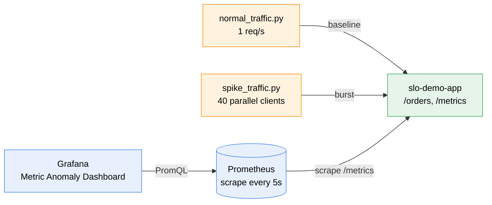
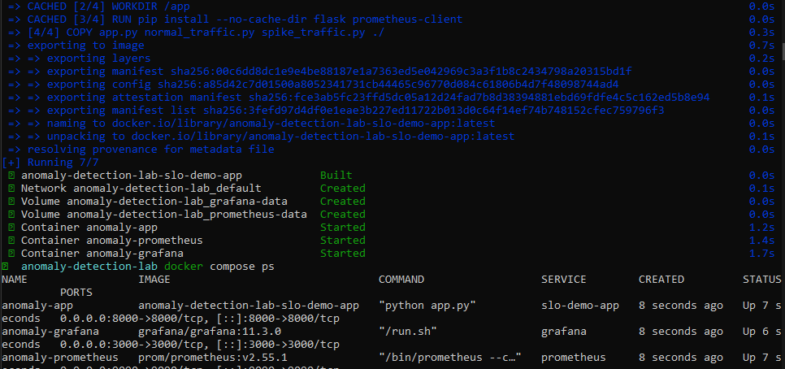
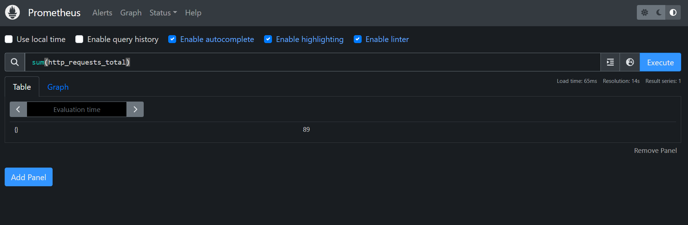
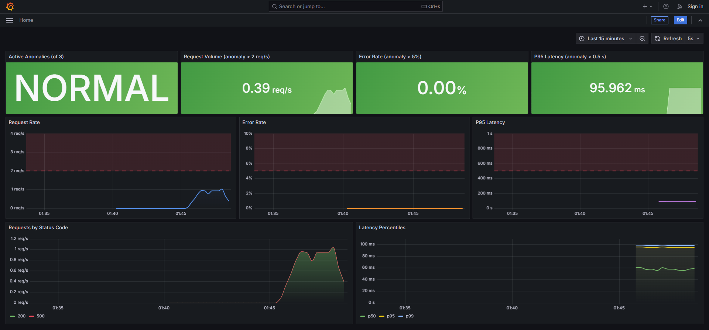
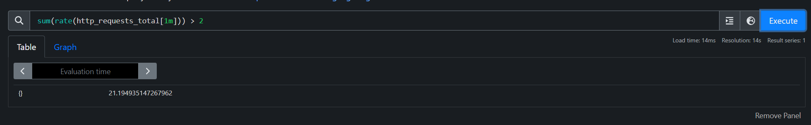
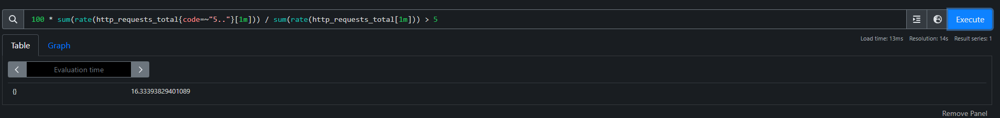
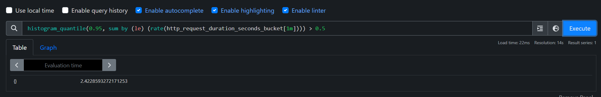
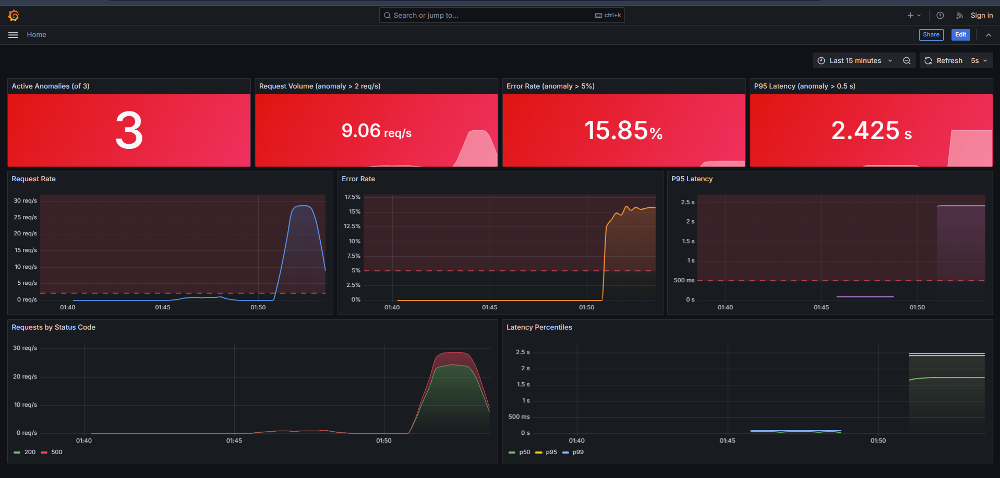
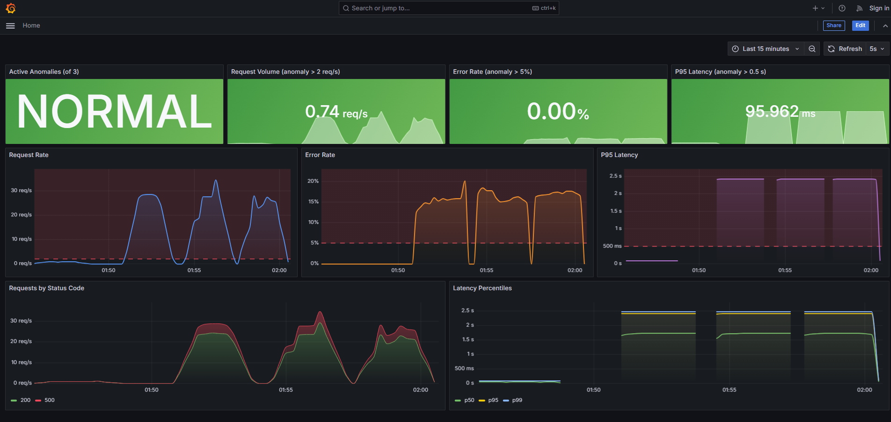

# Metric Anomaly Detection with Prometheus and Grafana

Hands-on lab: generate normal and spike traffic, then detect unusual request volume, error rate, and P95 latency with Prometheus queries and a threshold-based Grafana dashboard.

Part of: `module-03-sre-operations-and-toil / part-03-gitops-and-ai-for-site-reliability-engineering`

## Objectives

- Create a traffic baseline, then simulate a sudden spike
- Detect anomalies with PromQL threshold queries (volume, errors, latency)
- Visualize them with threshold-colored Grafana panels
- Understand why simple thresholds are a practical first step before ML-based detection

## Architecture



| Service | Role | Port |
|---|---|---|
| `slo-demo-app` | Flask API exposing request count, status codes, latency histogram | 8000 |
| `traffic` | Runs the traffic scripts on demand (`tools` profile) | - |
| `prometheus` | Scrapes and stores metrics | 9090 |
| `grafana` | Dashboard, provisioned automatically | 3000 |

The app slows down and starts failing when many requests overlap. This makes the spike produce all three anomalies, the way real systems degrade under load.

## Structure

```
anomaly-detection-lab/
├── docker-compose.yml
├── app/                         # demo app + normal and spike traffic scripts
├── prometheus/prometheus.yml
├── grafana/
│   ├── provisioning/            # datasource + dashboard provider
│   └── dashboards/metric-anomaly-dashboard.json
├── scripts/run-traffic.sh       # normal | spike [seconds]
└── docs/screenshots/
```

## Anomaly rules

| Signal | PromQL | Threshold |
|---|---|---|
| Request volume | `sum(rate(http_requests_total[1m]))` | > 2 req/s |
| Error rate | `100 * sum(rate(http_requests_total{code=~"5.."}[1m])) / sum(rate(http_requests_total[1m]))` | > 5% |
| P95 latency | `histogram_quantile(0.95, sum by (le) (rate(http_request_duration_seconds_bucket[1m])))` | > 0.5 s |

Appending `> <threshold>` to a query returns a result only while the anomaly is active.

## Prerequisites

| Tool | Check |
|---|---|
| Docker Engine / Desktop | `docker --version` |
| Docker Compose v2 | `docker compose version` |

Ports 8000, 9090 and 3000 must be free. Stop other labs first (`docker compose down -v`).

## Quick start

```bash
cd module-03-sre-operations-and-toil/part-03-gitops-and-ai-for-site-reliability-engineering/anomaly-detection-lab
docker compose up -d --build
docker compose ps
```



*Figure 1. The application, Prometheus and Grafana containers are running.*

| URL | What |
|---|---|
| http://localhost:3000 | Metric Anomaly Dashboard |
| http://localhost:9090 | Prometheus |
| http://localhost:8000/metrics | Raw application metrics |

## Step 1: Baseline with normal traffic

```bash
./scripts/run-traffic.sh normal 150
```

In Prometheus, run `sum(http_requests_total)` to confirm metrics are collected.



*Figure 2. The total request counter grows while normal traffic runs, so Prometheus is collecting data from the application.*



*Figure 3. Baseline: about 1 req/s, near-zero errors, low latency. All panels are green and Active Anomalies is NORMAL.*

## Step 2: Spike traffic and PromQL detection

```bash
./scripts/run-traffic.sh spike 120
```

Wait about 40 seconds, then run each query in Prometheus.



*Figure 4. `sum(rate(http_requests_total[1m])) > 2` returns a value far above the threshold, so the request volume anomaly is detected.*



*Figure 5. The error rate query returns a value above 5%. Overlapping requests push the app into failing.*



*Figure 6. P95 latency exceeds 0.5 s under the concurrent load.*

## Step 3: Grafana dashboard

The dashboard is provisioned from `grafana/dashboards/metric-anomaly-dashboard.json`. Edits made in the UI are not written back to the file.

| Panel | Query | Green | Red |
|---|---|---|---|
| Active Anomalies | sum of the three conditions | 0 | 2 or more (orange at 1) |
| Request Volume | request rate | < 2 req/s | >= 2 req/s |
| Error Rate | error percentage | < 5% | >= 5% |
| P95 Latency | P95 in seconds | < 0.5 s | >= 0.5 s |

Time series panels show a dashed threshold line with a shaded anomaly zone. The bottom row shows requests by status code and p50/p95/p99 latency.



*Figure 7. During the spike all three signals cross their thresholds, Active Anomalies shows 3, and 500 responses appear in the status code panel.*

## Step 4: Recovery

Wait about two minutes after the spike ends.



*Figure 8. After the spike the panels return to green. The graphs show the full pattern: baseline, spike, recovery.*

## Expected results

| Signal | Normal | Spike |
|---|---|---|
| Request rate | about 1 req/s | tens of req/s |
| Error rate | below 1% | about 10 to 15% |
| P95 latency | below 0.1 s | above 0.5 s |
| Active anomalies | 0 | 3 |

## Design notes

- Thresholds are static. They are easy to explain and a good starting point, but they do not adapt to daily traffic patterns the way ML-based detection can.
- `rate()` over a 1 minute window smooths noise but delays detection by a few seconds.
- The error rate query divides by `clamp_min(...)` to avoid `NaN` when there is no traffic.
- The dashboard is provisioned so the lab is reproducible. Anonymous access is enabled for convenience and must not be used outside a local lab.
- The spike is self-limiting: the app slows down as concurrency grows, which keeps the load on the machine bounded.

## Troubleshooting

| Symptom | Fix |
|---|---|
| Port already in use | `docker compose down -v` in the previous lab folder |
| Dashboard shows no data | Check Prometheus Status > Targets, and run normal traffic first |
| Threshold query returns "Empty query result" | The anomaly is not active yet. Wait 15 to 20 seconds into the spike |
| `bad interpreter ... ^M` on WSL | `sed -i 's/\r$//' scripts/*.sh` |
| Dashboard changes lost | It is file-provisioned. Edit the JSON and run `docker compose restart grafana` |
| P95 panel shows 0 when idle | Expected, there is no traffic to measure |

## Cleanup

```bash
docker compose down -v
```
