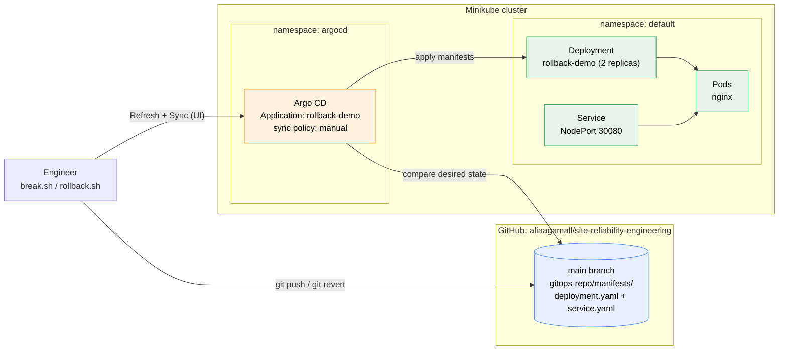
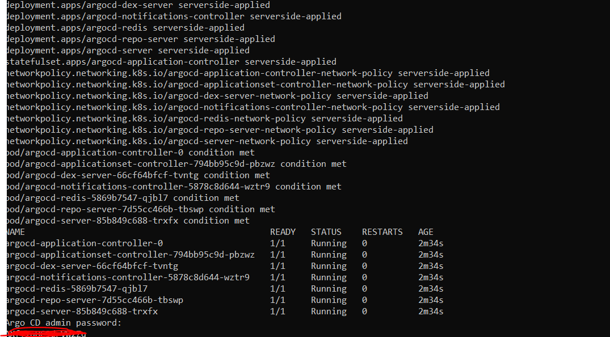
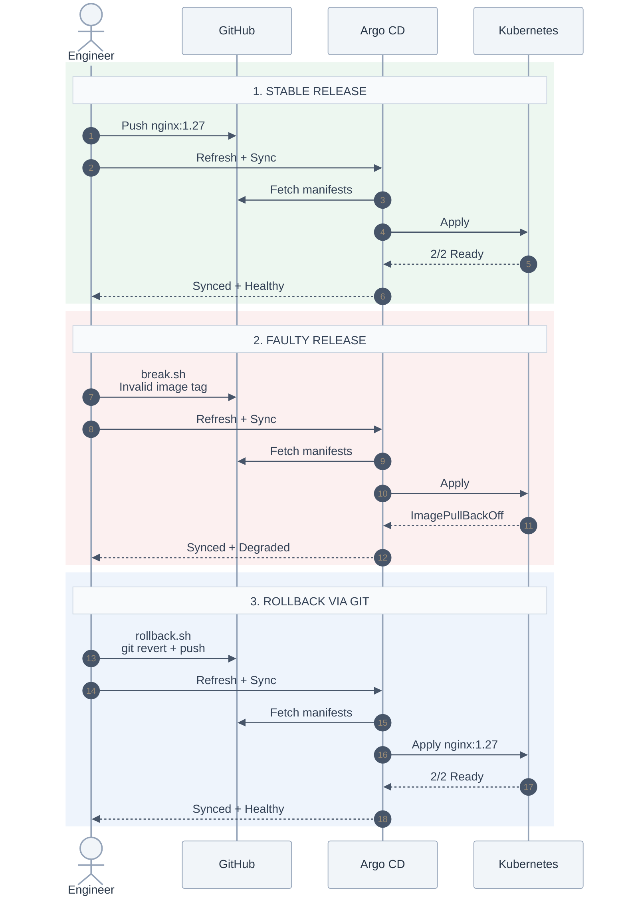
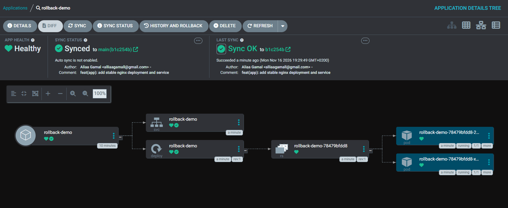

# GitOps Rollback with Argo CD on Kubernetes

Hands-on lab: deploy a stable application through Git with Argo CD, push a faulty version, observe the degraded state, and recover by reverting the Git commit.

Part of: `module-03-sre-operations-and-toil / part-03-gitops-and-ai-for-site-reliability-engineering`

## Objectives

- Run Argo CD on a local Minikube cluster
- Define an Argo CD Application declaratively (`argocd/application.yaml`)
- Deploy through Git with manual sync
- Simulate a bad release and observe the degraded state
- Roll back with `git revert`, not by editing the cluster

## Architecture



Source of truth is Git. The cluster is never edited by hand.

## Structure

```text
argocd-rollback-lab/
├── argocd/application.yaml        # Argo CD Application
├── gitops-repo/manifests/         # path tracked by Argo CD
│   ├── deployment.yaml            # nginx:1.27, 2 replicas
│   └── service.yaml               # NodePort 30080
├── scripts/
│   ├── install-argocd.sh          # Minikube + Argo CD + admin password
│   ├── status.sh                  # app, deployment, pods, image
│   ├── break.sh                   # push faulty image to Git
│   ├── rollback.sh                # git revert + push
│   └── cleanup.sh
└── docs/screenshots/
```

The lab lives inside the main SRE repo. Argo CD tracks only the `gitops-repo/manifests` path, so unrelated commits elsewhere in the repo do not affect the application.

## Application definition

| Field | Value | Why |
|---|---|---|
| `metadata.name` | `rollback-demo` | Application name |
| `spec.project` | `default` | Default Argo CD project |
| `source.repoURL` | `https://github.com/aliaagamall/site-reliability-engineering.git` | Source of truth |
| `source.targetRevision` | `main` | Branch to track |
| `source.path` | `module-03-sre-operations-and-toil/part-03-gitops-and-ai-for-site-reliability-engineering/argocd-rollback-lab/gitops-repo/manifests` | Folder with Kubernetes manifests |
| `destination.server` | `https://kubernetes.default.svc` | The cluster Argo CD runs in |
| `destination.namespace` | `default` | Target namespace |
| `syncPolicy` | not set | Manual sync, each version is applied on purpose |

## Prerequisites

| Tool | Check |
|---|---|
| Docker | `docker --version` |
| Minikube | `minikube version` |
| kubectl | `kubectl version --client` |
| git + GitHub account | `git --version` |

- Minikube needs about 2 CPUs and 4 GB RAM.
- The GitHub repo must be public, otherwise Argo CD needs repository credentials.
- On WSL with the repo under `/mnt/<drive>`, remove CRLF from the scripts: `sed -i 's/\r$//' scripts/*.sh`.

## Setup

```bash
cd module-03-sre-operations-and-toil/part-03-gitops-and-ai-for-site-reliability-engineering/argocd-rollback-lab
./scripts/install-argocd.sh
```



*Figure 1. All Argo CD pods in namespace `argocd` are Running.*

Open the UI (separate terminal):

```bash
kubectl port-forward svc/argocd-server -n argocd 8080:443
```

Login at `https://localhost:8080` with user `admin` and the initial password from the install script.

Argo CD pulls from GitHub, so push the lab files first:

```bash
export GITOPS_REPO_DIR=$(git rev-parse --show-toplevel)
git add .
git commit -m "feat(gitops-lab): add Argo CD GitOps rollback lab on Minikube"
git push origin main
```

Create the Application:

```bash
kubectl apply -f argocd/application.yaml
kubectl get app -n argocd
```


*Figure 2. Right after creation the application is OutOfSync because nothing has been synced yet.*

## Lab steps



| # | Step | Action |
|---|---|---|
| 1 | Sync stable version | UI: Sync > Synchronize |
| 2 | Verify | `./scripts/status.sh` |
| 3 | Push faulty version | `./scripts/break.sh` |
| 4 | Refresh + sync in UI | Argo CD applies the bad state |
| 5 | Observe failure | `./scripts/status.sh` |
| 6 | Roll back in Git | `./scripts/rollback.sh` |
| 7 | Refresh + sync in UI | Argo CD applies the restored state |
| 8 | Verify recovery | `./scripts/status.sh` |

Do not create any other commit between `break.sh` and `rollback.sh`. The rollback script aborts unless the latest commit is the faulty one.

### Stable version



*Figure 3. After the first sync the application is Synced and Healthy.*


*Figure 4. Two `rollback-demo` pods are Running, the deployment shows 2/2 ready, and the image is `nginx:1.27`.*

### Faulty version

```bash
./scripts/break.sh
```

Refresh and sync the application in the UI.


*Figure 5. Argo CD reports the application as Degraded. It is still Synced, because the cluster matches Git, but the desired state in Git is unhealthy.*


*Figure 6. The new pod cannot pull the invalid image and shows `ErrImagePull` then `ImagePullBackOff`.*

### Rollback

```bash
./scripts/rollback.sh
```


*Figure 7. Git history shows the revert commit on top of the faulty commit. The rollback is a new commit, the history is preserved.*

Refresh and sync the application in the UI.


*Figure 8. After syncing the revert commit the application is Synced and Healthy again, with 2/2 ready replicas on `nginx:1.27`.*

Commit the screenshots only after the rollback is finished.

## Expected results

| Stage | Git | Argo CD | Pods | Image |
|---|---|---|---|---|
| Stable | commit 1 | Synced, Healthy | 2/2 Running | `nginx:1.27` |
| Faulty | commit 2 | Synced, Degraded | new pod `ImagePullBackOff` | `nginx:does-not-exist-99` |
| Rolled back | commit 3 (revert) | Synced, Healthy | 2/2 Running | `nginx:1.27` |

## Design notes

- Manual sync keeps every version change visible and controlled.
- `progressDeadlineSeconds: 60` makes Argo CD report Degraded after 1 minute instead of the default 10 minutes.
- The default RollingUpdate keeps the old healthy pods serving while the new pod fails. You may see `READY 2/2` during the failure while Argo CD is already Degraded. Kubernetes protected availability, Argo CD still reports that the desired state is unhealthy.
- After the revert, the pod template matches the original, so Kubernetes reuses the old ReplicaSet. Check with `kubectl rollout history deploy/rollback-demo`.
- Rollback is a new commit (`git revert`), so history stays auditable: what changed, who changed it, and how it was restored.
- The Argo CD UI has its own rollback button. It is intentionally not used, because it changes the cluster without changing Git.
- `break.sh` and `rollback.sh` use `GITOPS_REPO_DIR` (the SRE repo root) and a full manifest path, because the lab is part of the main repo.

## Troubleshooting

| Symptom | Fix |
|---|---|
| `metadata.annotations: Too long` on install | Use `--server-side --force-conflicts` (already in the script) |
| Argo CD pods Pending | Give Minikube more resources: `minikube start --cpus=2 --memory=4096` |
| `authentication required: Repository not found` | Repo is private or `repoURL` is wrong. Make it public or add credentials, then check `kubectl get app rollback-demo -n argocd -o jsonpath='{.spec.source.repoURL}'` |
| `path ... does not exist` | Push the lab files first and check `source.path` matches the folder on GitHub |
| UI does not show the new commit | Hard refresh: `kubectl -n argocd annotate app rollback-demo argocd.argoproj.io/refresh=hard --overwrite` |
| App stays Synced after `break.sh` | Check the push reached GitHub: `git log origin/main --oneline -3` |
| `break.sh` fails with unset variable | `export GITOPS_REPO_DIR=$(git rev-parse --show-toplevel)` |
| `rollback.sh` says latest commit is not the faulty one | Another commit was made after `break.sh`. Revert the faulty commit manually with `git revert <sha>` |
| `bad interpreter ... ^M` | `sed -i 's/\r$//' scripts/*.sh` |
| `localhost:8080` certificate warning | Expected with the self-signed certificate, continue |
| Port 8080 already in use | Use another local port: `port-forward ... 8443:443` |

## Cleanup

```bash
./scripts/cleanup.sh            # remove the app and the argocd namespace
./scripts/cleanup.sh --cluster  # also delete the Minikube cluster
```

## Extension ideas

- Enable auto-sync with `selfHeal` and `prune`, and compare the behavior
- Add a `Rollout` with Argo Rollouts for canary and automatic abort
- Manage the Application itself with an app-of-apps pattern
- Add a CI check that validates manifests (`kubectl apply --dry-run=server`) before merge