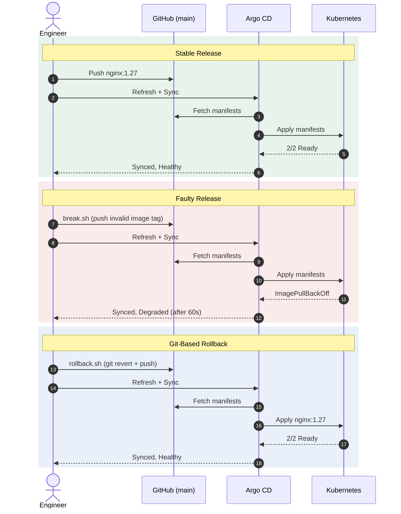
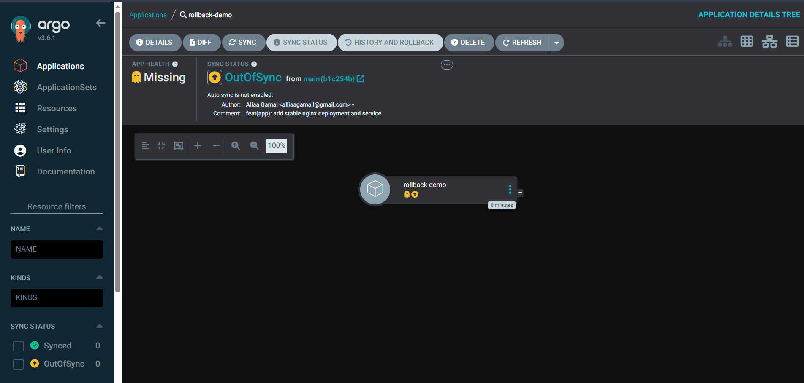
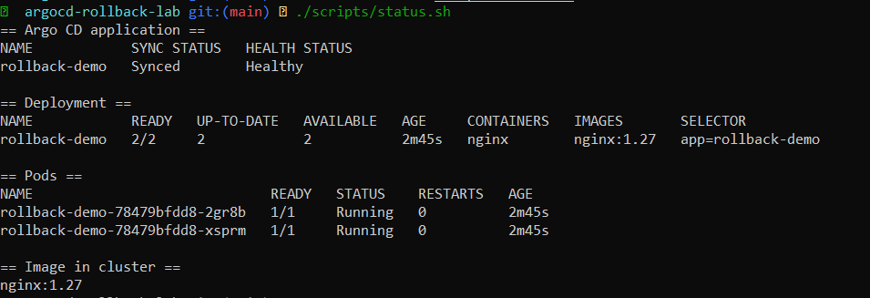
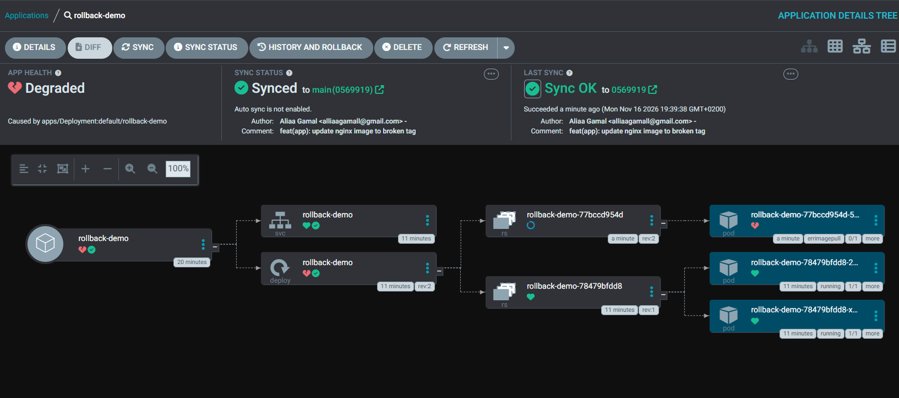
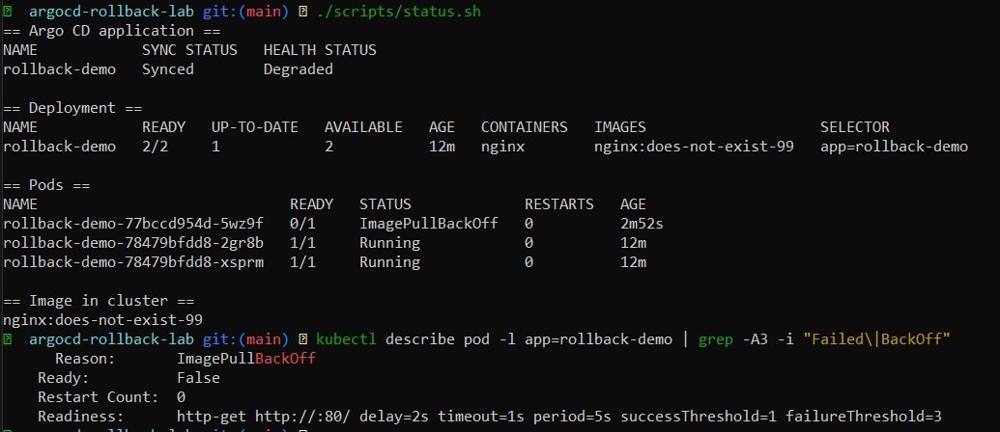
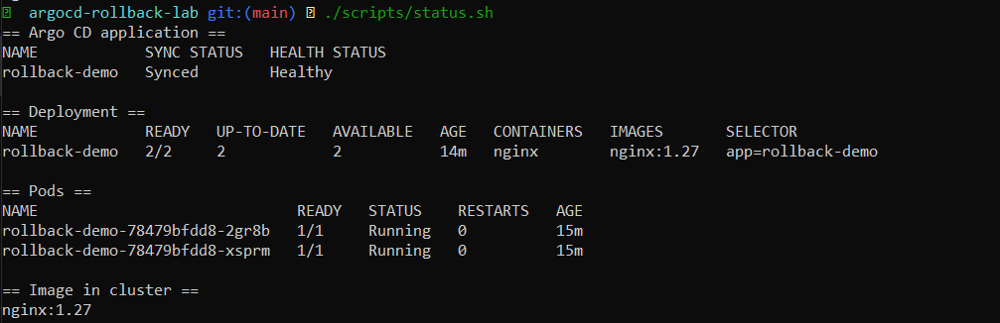
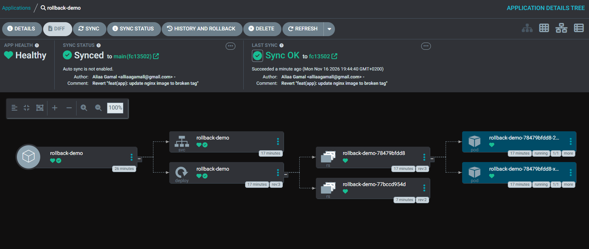

# Argo CD Rollback Lab

A hands-on GitOps lab demonstrating application deployment, failure detection, and recovery through Git-based rollback using Argo CD and Kubernetes.

## Overview

This lab demonstrates how Argo CD continuously monitors the desired application state stored in Git and synchronizes it with a Kubernetes cluster.

The exercise covers three deployment scenarios:

1. **Stable Release:** Deploy a valid NGINX image and verify that the application reaches a healthy state.
2. **Faulty Release:** Introduce an invalid image tag and observe how Kubernetes and Argo CD report the deployment failure.
3. **Git-Based Rollback:** Revert the faulty Git commit and allow Argo CD to restore the previous healthy application state.

## Architecture and Workflow

The following sequence diagram illustrates the complete deployment and recovery lifecycle.



## Lab Objectives

- Understand GitOps deployment workflows.
- Configure an Argo CD application to track Git manifests.
- Synchronize Kubernetes resources through Argo CD.
- Observe OutOfSync, Synced, Healthy, and Degraded states.
- Simulate an image-pull failure.
- Understand Kubernetes `ImagePullBackOff`.
- Perform Git-based rollback using `git revert`.
- Verify application recovery and synchronization.

## Repository Structure

```text
argocd-rollback-lab/
├── README.md
├── argocd/
│   └── application.yaml
├── docs/
│   └── screenshots/
│       ├── 01-argocd-pods-running.png
│       ├── 02-app-outofsync.png
│       ├── 03-stable-healthy-synced.png
│       ├── 04-stable-pods.png
│       ├── 05-faulty-degraded.png
│       ├── 06-faulty-pods.png
│       ├── 07-rollback.png
│       └── 08-recovered-healthy.png
├── gitops-repo/
│   └── manifests/
│       ├── deployment.yaml
│       └── service.yaml
└── scripts/
    ├── break.sh
    ├── cleanup.sh
    ├── install-argocd.sh
    ├── rollback.sh
    └── status.sh
```

## Tools and Technologies

- **Version Control:** Git, GitHub
- **GitOps:** Argo CD
- **Container Orchestration:** Kubernetes
- **Container Image:** NGINX
- **Configuration:** Kubernetes YAML manifests
- **Automation:** Bash scripts

## Implementation Workflow

### 1. Environment Setup

Install Argo CD and prepare the Kubernetes environment.

Script: `scripts/install-argocd.sh`

### 2. Stable Deployment

Deploy the application using the valid `nginx:1.27` image.

Verify that:

- Argo CD reports the application as Synced and Healthy.
- Both application pods reach the Ready state.
- Kubernetes successfully runs the requested image.

### 3. Fault Injection

Run `scripts/break.sh` to introduce an invalid NGINX image tag.

Observe:

- The application becomes OutOfSync before synchronization.
- Argo CD applies the updated manifest.
- Kubernetes reports `ImagePullBackOff`.
- Argo CD transitions the application to Degraded after its health evaluation.

### 4. Git-Based Recovery

Run `scripts/rollback.sh` to revert the faulty Git commit and push the previous configuration.

After synchronization, verify that:

- The deployment uses `nginx:1.27` again.
- Both pods return to Ready.
- Argo CD reports Synced and Healthy.

### 5. Status Verification and Cleanup

Use the following scripts:

- `scripts/status.sh` — Inspect the current lab status.
- `scripts/cleanup.sh` — Clean up the lab resources.

## Practical Evidence

The following screenshots document the actual execution and validation of the lab.

| Stage | Evidence |
|---|---|
| Environment Setup |  |
| OutOfSync Detection |  |
| Stable Application |  |
| Stable Kubernetes Pods |  |
| Faulty Deployment |  |
| Image Pull Failure |  |
| Git-Based Rollback |  |
| Successful Recovery |  |

## Key Takeaways

- Git serves as the source of truth for the desired application state.
- Argo CD continuously reconciles the actual Kubernetes state with the Git-defined state.
- A successful synchronization does not necessarily mean an application is healthy.
- Kubernetes can accept a deployment configuration even when its containers cannot start.
- Argo CD health status helps identify application-level deployment problems.
- Git-based rollback restores a previously committed desired state without manually editing the Kubernetes resources.

## Final Result

The lab demonstrates a complete GitOps recovery cycle:

**Deploy → Detect Failure → Diagnose → Revert → Synchronize → Recover**

This reinforces the role of GitOps in maintaining consistent, auditable, and recoverable application deployments.