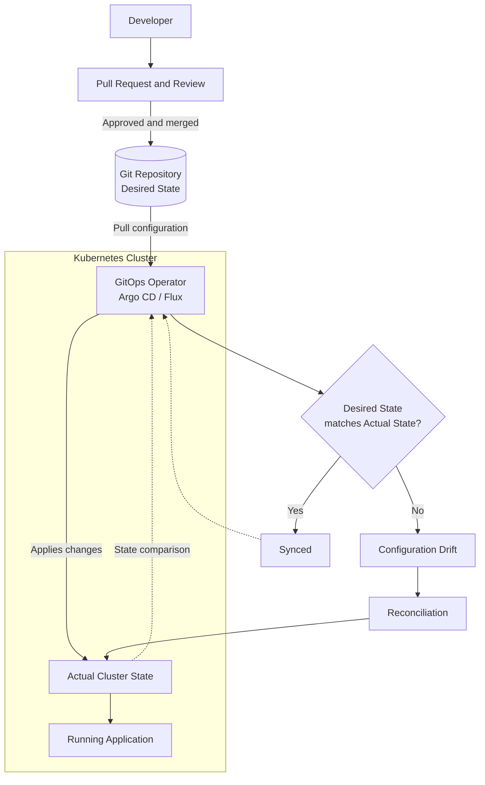
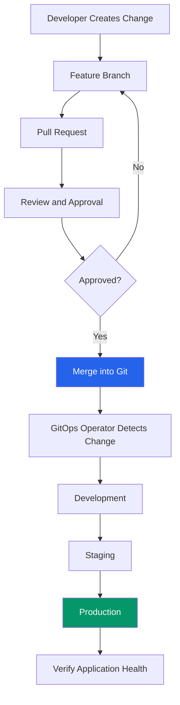
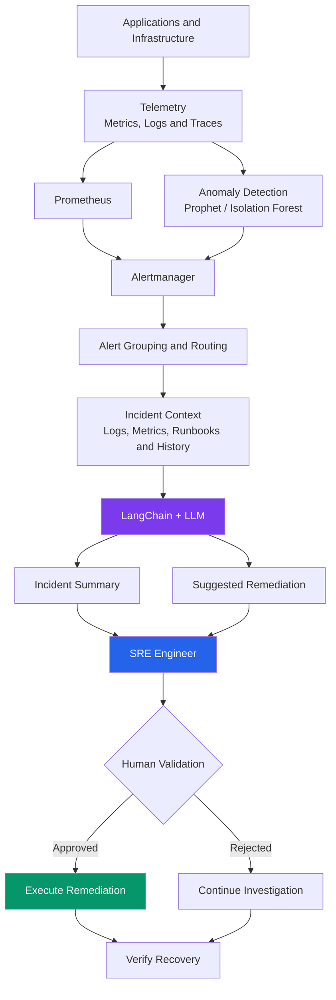

# GitOps and AI for Site Reliability Engineering

## 1. GitOps for Reliable Operations

### 1.1 What Is GitOps?

GitOps is an operational model where Git acts as the **single source of truth** for the desired state of an application and its infrastructure.

Instead of manually configuring servers or executing ad-hoc deployment scripts, teams define the desired system state as code and store it in Git.

This includes:

- Application configurations.
- Infrastructure definitions.
- Kubernetes manifests.
- Deployment specifications.

The Git repository becomes the central record of what the system is expected to look like.

### 1.2 How GitOps Works

GitOps relies on two key ideas:

**1. Desired State as Code**

The team describes the expected state of the application and infrastructure in version-controlled files.

For example, a Kubernetes manifest may declare:

- The application image to deploy.
- The number of replicas.
- Resource requests and limits.
- Service and networking configuration.

Instead of manually applying changes directly to production, the team updates the configuration in Git.

**2. Continuous Reconciliation**

A GitOps operator continuously watches the repository and compares the declared desired state with the actual state of the live environment.

If differences are detected, the operator works to bring the environment back into alignment with Git.

Examples of GitOps operators include:

- Argo CD.
- Flux.

This process reduces the need for manual synchronization.

**Important:** GitOps-managed production changes should normally go through Git rather than direct manual modifications. The operator can detect configuration drift and, when configured to do so, correct it automatically.

### GitOps Architecture and Reconciliation

## 2. Core Principles of GitOps

GitOps is based on five core principles.

### 2.1 Declarative Configuration

Declarative configuration describes **what the desired state should be**, rather than providing a sequence of commands explaining how to achieve it.

The GitOps tooling determines how to reconcile the live environment with the declared state.

For example, instead of manually creating three application replicas, a Kubernetes manifest declares that the desired replica count is three.

### 2.2 Versioned and Immutable

Every configuration change is recorded as a Git commit.

This provides:

- A history of changes.
- Information about when changes happened.
- Information about who made or approved changes.
- The ability to compare versions and revert unwanted changes.

The history provides traceability and helps teams understand how the system reached its current state.

### 2.3 Pulled Automatically

GitOps uses a pull-based deployment model.

The GitOps operator runs in or has access to the target environment and pulls the desired configuration from Git.

This differs from traditional push-based deployment approaches, where an external deployment process sends changes directly to the environment.

### 2.4 Continuously Reconciled

Continuous reconciliation means the operator repeatedly compares the actual environment with the desired state stored in Git.

If a difference, known as configuration drift, is detected, the operator attempts to correct it according to its configuration.

This makes GitOps systems more consistent and can provide self-healing behavior for configuration drift.

### 2.5 Auditable by Default

Because changes are recorded in Git, teams have an audit trail of configuration and deployment changes.

This supports:

- Compliance requirements.
- Incident investigations.
- Root cause analysis (RCA).
- Change reviews.
- Accountability across engineering teams.

## 3. How GitOps Improves Reliability

Each GitOps principle contributes to system reliability.

### 3.1 Drift Detection and Correction

Configuration drift happens when the actual environment differs from the desired configuration stored in Git.

For example, someone manually changes the replica count of a production deployment.

A GitOps operator can detect this difference and reconcile the environment with the declared configuration.

This reduces configuration inconsistencies and unintended manual changes.

### 3.2 Repeatable Deployments

Deployments are driven by version-controlled configuration.

Using the same commit and compatible deployment tooling helps teams reproduce the declared configuration across environments.

This reduces configuration differences between development, staging, and production.

### 3.3 Simple Rollbacks

If a configuration change causes problems, the team can revert the Git commit that introduced it.

The GitOps operator then reconciles the environment toward the previous declared state.

This provides a predictable recovery process without requiring teams to manually reconstruct the previous configuration.

### 3.4 Smaller Changes and Reduced Blast Radius

GitOps workflows commonly use pull requests and incremental changes.

Each change can be reviewed before it reaches the main branch.

Smaller, reviewed changes help teams:

- Identify problems earlier.
- Understand the impact of each change.
- Limit the potential blast radius.
- Reduce the risk of large unreviewed modifications.

### 3.5 Audit Trail for Compliance and RCA

Git history records changes to deployment and infrastructure configuration.

During an incident, engineers can review:

- Which commit introduced a change.
- When the change was merged.
- What configuration was modified.
- Which changes were reverted.

This makes incident investigation and root cause analysis easier.

## 4. GitOps Tools

Two widely used GitOps operators are Argo CD and Flux.

### 4.1 Argo CD

Argo CD is a declarative GitOps continuous delivery tool for Kubernetes.

It:

- Watches Git repositories.
- Compares the repository's desired state with the live Kubernetes cluster.
- Synchronizes the cluster with the declared configuration.
- Provides visibility into synchronization status and configuration drift.

### 4.2 Flux

Flux is a GitOps toolkit for Kubernetes that automates synchronization between Git repositories and cluster state.

It follows the pull-based reconciliation model and provides components for managing Kubernetes resources and application delivery.

### 4.3 Argo CD vs. Flux

| Feature | Argo CD | Flux |
|---|---|---|
| Main purpose | GitOps continuous delivery | GitOps automation and continuous delivery |
| Platform | Kubernetes | Kubernetes |
| Reconciliation | Continuously compares and syncs desired and live state | Continuously reconciles desired and live state |
| Visibility | Provides a web UI and synchronization status | Primarily designed around controllers and Kubernetes resources |

Both tools help teams manage Kubernetes deployments through Git and reduce manual configuration changes.

## 5. GitOps Workflow in Practice

A typical GitOps workflow follows these steps:

1. **Developer creates a change:** A developer updates application or infrastructure configuration in a feature branch.
2. **Pull request:** The developer opens a PR for review.
3. **Review and approval:** Teammates inspect and approve the changes.
4. **Merge:** The approved change is merged into the main branch.
5. **Detection:** The GitOps operator detects the updated desired state in Git.
6. **Reconciliation:** The operator compares the new desired state with the live cluster and applies the required changes.
7. **Verification:** The team checks the synchronization status and application health.

The deployment is driven by Git changes, so manual deployment commands are not required as part of the normal GitOps synchronization process.

### 5.1 Environment Promotion

A GitOps repository can manage multiple environments, such as:

- Development.
- Staging.
- Production.

Environment configurations may be organized using separate directories or branches.

A change can be tested in development, promoted to staging, and then promoted to production through reviewed Git changes.

For example:

**Development → Staging → Production**

Promotion through Git makes the process traceable and controlled.

### GitOps Workflow

## 6. AI for Site Reliability Engineering

### 6.1 Why AI Matters in SRE

Modern systems generate large amounts of telemetry, including metrics, logs, and traces.

Monitoring all this data manually becomes difficult as systems grow.

Traditional static alert thresholds can also generate large numbers of notifications, many of which may not require action.

This creates two major challenges:

- **Massive telemetry:** Large volumes of operational data are difficult to analyze manually.
- **Alert noise:** Excessive or non-actionable alerts create alert fatigue and can hide important problems.

AI can help SRE teams analyze system behavior, identify unusual patterns, and prioritize meaningful operational signals.

Instead of relying only on fixed thresholds, AI-based approaches can learn patterns from historical and current system data.

## 7. Five Core AI Capabilities in SRE

### 7.1 Early Detection

AI can analyze metrics, logs, and traces to identify unusual behavior.

It can detect deviations from normal system patterns, including anomalies that may not be captured by manually configured static thresholds.

This helps teams identify potential problems earlier.

### 7.2 Intelligent Alert Grouping

A single incident may generate many related alerts across different services and components.

AI can group related alerts into one incident or event, helping engineers focus on the underlying problem instead of handling every notification separately.

### 7.3 Incident Summarization

AI can generate concise incident summaries using available operational information.

A summary may include:

- What happened.
- Which services were affected.
- Relevant symptoms.
- Important logs or events.
- Potential contributing factors.

This helps responders understand the situation more quickly.

### 7.4 Predictive Insights

AI can analyze historical data and system behavior trends to identify patterns that may indicate future failures.

Examples include:

- Increasing resource utilization.
- Gradual performance degradation.
- Unusual traffic patterns.
- Capacity-related risks.

Predictive insights help teams investigate potential issues before they affect users.

### 7.5 Suggested Remediation

AI can analyze incident information, historical solutions, and runbooks to recommend possible recovery actions.

For example, it may suggest checking database connection limits when application errors increase alongside database connection saturation.

These recommendations should be evaluated by engineers before applying potentially risky changes.

## 8. Industry AI Tools for SRE

Several industry platforms provide AI-powered capabilities for observability and reliability management.

### 8.1 Datadog Watchdog

Datadog Watchdog uses AI and machine learning to identify anomalies across application performance monitoring (APM), infrastructure, and logs.

It helps surface unusual system behavior without requiring teams to manually define every anomaly detection rule.

### 8.2 Dynatrace Davis AI

Dynatrace Davis AI analyzes observability data to identify problems and help determine their root causes.

It can also reduce downstream alert noise by connecting related events and identifying their likely underlying cause.

### 8.3 StackGen

StackGen applies AI to infrastructure as code (IaC) workflows.

It helps teams work with infrastructure definitions and automate parts of infrastructure management, reducing manual operational effort.

### 8.4 Common Goal

These platforms demonstrate how AI can support SRE through:

- Continuous anomaly detection.
- Less manual alert tuning.
- Better incident investigation.
- Reduced operational toil.
- Faster identification of potential root causes.

## 9. Open-Source Tools for AI-Augmented SRE

AI-driven reliability workflows can also be built using open-source tools.

The video introduces several tools that can provide similar capabilities without depending entirely on proprietary enterprise platforms.

### 9.1 Prophet

Prophet is a time-series forecasting tool that can model trends and seasonality in historical data.

In SRE workflows, it can help forecast system metrics such as:

- Request traffic.
- Resource utilization.
- Application load.

Forecasts can help teams identify unexpected deviations from expected behavior.

### 9.2 Isolation Forest

Isolation Forest is an unsupervised machine learning algorithm used for anomaly detection.

It identifies unusual data points by isolating observations that differ from normal patterns.

In SRE, it can be applied to telemetry data to detect unusual behavior without requiring manually labeled examples of every possible failure.

### 9.3 Prometheus and Alertmanager

These tools provide the observability foundation for AI-augmented SRE workflows.

**Prometheus:**

- Collects and stores time-series metrics.
- Evaluates monitoring queries.
- Supports rule-based alert generation.

**Alertmanager:**

- Receives alerts from Prometheus.
- Groups related alerts.
- Routes notifications.
- Handles alert silencing and inhibition.

AI capabilities can be added alongside this monitoring foundation to improve anomaly detection, alert prioritization, and incident analysis.

### 9.4 LangChain and LLMs

LangChain is a framework for building applications powered by large language models (LLMs).

In SRE workflows, LangChain and LLMs can help with:

- Incident summarization.
- Searching and using runbook information.
- Analyzing incident history.
- Suggesting possible remediation steps.

For example, an LLM-based workflow can receive relevant logs and incident context, retrieve a related runbook, and generate a summary with suggested investigation steps.

### 9.5 Open-Source AI-Augmented SRE Workflow

A simplified workflow can look like this:

1. Prometheus collects system metrics.
2. Anomaly detection tools analyze telemetry and identify unusual patterns.
3. Alertmanager groups and routes alerts.
4. Incident information, logs, runbooks, and historical incidents provide context.
5. LangChain and an LLM generate an incident summary and suggest possible remediation.
6. An engineer reviews the findings and decides what action to take.

This approach combines traditional observability with AI-assisted analysis.

**Important:** AI recommendations are not guaranteed to be correct. Critical operational actions should have appropriate validation and human approval.

### AI-Augmented SRE Workflow

## 10. Key Takeaways

### GitOps

- Git acts as the single source of truth for desired application and infrastructure state.
- Declarative configuration describes the expected system state.
- GitOps operators pull configuration from Git and continuously reconcile the live environment.
- Drift detection and reconciliation help maintain consistency.
- Git history supports traceability, compliance, and root cause analysis.
- Argo CD and Flux are widely used GitOps tools for Kubernetes.
- Reviewed Git changes make deployments more controlled and repeatable.

### AI for SRE

- AI helps teams handle massive telemetry and reduce alert noise.
- Early detection identifies unusual system behavior.
- Intelligent alert grouping reduces duplicate notifications.
- Incident summarization helps responders understand failures quickly.
- Predictive insights help identify potential reliability risks.
- Suggested remediation can support investigation and recovery.
- Tools such as Datadog Watchdog, Dynatrace Davis AI, and StackGen provide industry AI capabilities.
- Open-source tools such as Prophet, Isolation Forest, Prometheus, Alertmanager, and LangChain can support AI-augmented SRE workflows.
- AI should assist engineering decisions, not replace validation and operational responsibility.

**Final Principle:** GitOps improves operational reliability through consistent, auditable, and repeatable changes. AI extends SRE capabilities by helping teams detect, understand, and respond to reliability problems more intelligently.