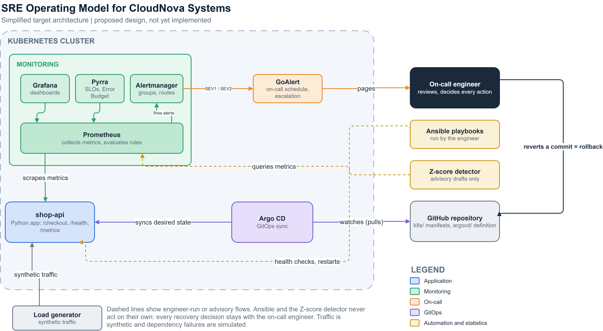

# Module 04 — SRE Operating Model for CloudNova Systems

**A practical SRE operating model built around a single application on Kubernetes.**

CloudNova Systems is a fictional company that needs a structured approach to application reliability.

This project develops and implements an SRE operating model around one Python HTTP application, `shop-api`, running on a local Kubernetes `kind` cluster.

The application exposes a checkout operation and supports controlled failure scenarios. This makes it possible to practice reliability measurement, monitoring, incident response, automation, and recovery without real customer traffic or cloud infrastructure.

## Architecture

The following diagram illustrates the overall architecture of the SRE operating model, including the application, monitoring stack, incident management, GitOps, and automation components.



## SRE Capabilities

The project covers six areas:

- **Reliability Measurement:** Define SLIs, SLOs, Error Budgets, and release policies.
- **Observability:** Collect metrics, build Grafana dashboards, and configure actionable alerts.
- **Incident Management:** Define incident response, on-call escalation, runbooks, and postmortems.
- **Toil Reduction:** Automate operational checks and recovery tasks using Ansible.
- **GitOps Recovery and AI:** Manage application configuration through GitOps, test rollback procedures, and build a lightweight statistical anomaly detector using Z-scores.
- **Governance and Continuous Improvement:** Track changes, document decisions, and review reliability practices.

## Project Approach

The project follows a design-first approach:

1. Define the scope and architecture.
2. Document the SRE capabilities and operational workflows.
3. Implement the application and supporting tools.
4. Test reliability and recovery scenarios.
5. Capture evidence and update the project report.

## Status Legend

| Status | Meaning |
|---|---|
| **Implemented** | Built and verified with evidence |
| **Configured** | Configuration exists but has not been fully tested |
| **Design only** | Documented but not implemented |
| **Planned** | Not started yet |

## Requirement Areas

| Area | Topic | Status |
|---|---|---|
| 4.1 | Reliability Measurement and SLOs | Design only |
| 4.2 | Observability, Dashboards, and Alerting | Design only |
| 4.3 | Incident Management and On-call | Design only |
| 4.4 | Toil Reduction | Design only |
| 4.5 | GitOps Recovery and AI | Design only |
| 4.6 | Governance and Continuous Improvement | Design only |

## Project Structure

Folders will be created as their implementation begins.

```text
module-04-sre-operating-model/
├── README.md
├── docs/
│   ├── 00-scope-and-architecture.md
│   ├── 01-slo-strategy.md
│   ├── 02-observability-and-alerting.md
│   ├── 03-incident-management.md
│   ├── 04-toil-and-automation.md
│   ├── 05-gitops-and-ai.md
│   ├── 06-governance.md
│   ├── architecture/
│   │   └── cloudnova_sre_architecture.svg
│   └── presentation/
│       ├── sre-operating-model-presentation.pdf
│       └── sre-operating-model-presentation.pptx
├── app/           # shop-api application and Dockerfile
├── loadgen/       # load generator
├── tests/         # local test scripts
├── cluster/       # kind configuration and scripts
├── k8s/           # Kubernetes manifests managed by Argo CD
├── argocd/        # Argo CD Application definition
├── monitoring/    # Prometheus, Grafana, Pyrra, and alert rules
├── oncall/        # GoAlert configuration
├── runbooks/      # Operational procedures
├── postmortems/   # Postmortem template and reports
├── ansible/       # Operational automation
└── ai/            # Anomaly detection and incident summaries
```

## Environment

- Python application: `shop-api`
- Local Kubernetes: `kind`
- Monitoring: Prometheus and Grafana
- SLO tracking: Pyrra
- Alerting: Alertmanager and GoAlert
- GitOps: GitHub and Argo CD
- Automation: Ansible
- No cloud resources required