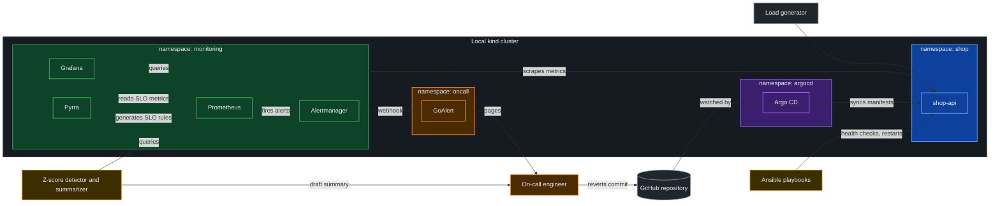

# 00 — Scope and Architecture

## 1. Purpose

This document defines what the project covers, what it deliberately leaves out, and the target architecture. All later design documents (4.1–4.6) refer back to it.

## 2. Business Scenario

CloudNova Systems runs several customer-facing services on Kubernetes. As the number of applications and environments grows, reliability is managed informally. This project designs an SRE operating model that makes reliability measurable, observable, automated, and recoverable.

### Problems and the capabilities that address them

| # | Problem at CloudNova | Capability in this project | Area |
|---|---|---|---|
| 1 | Reliability is discussed informally; no consistent SLIs, SLOs, or error budgets | SLI/SLO definitions, error budget policy, Pyrra tracking | 4.1 |
| 2 | No standard dashboards for health, latency, errors, availability | Prometheus metrics and Grafana dashboards | 4.2 |
| 3 | Alerts are noisy and do not show user impact | Symptom-based and burn-rate alerts with severity levels | 4.2 |
| 4 | Incident response and escalation are inconsistent | Incident lifecycle, severity matrix, GoAlert escalation | 4.3 |
| 5 | Postmortems are unstructured | Blameless postmortem template and corrective action tracking | 4.3 |
| 6 | Operational tasks are manual | Markdown runbooks and Ansible playbooks | 4.4 |
| 7 | Rollback steps are not standardized | GitOps rollback with GitHub and Argo CD | 4.5 |
| 8 | Interest in AI-assisted reliability with human oversight | Z-score anomaly detection and templated incident summaries | 4.5 |
| 9 | Decisions are hard to trace | Version-controlled configs, PR reviews, operational records | 4.6 |

## 3. Scope

### In scope

- One small Python service (`shop-api`) with runtime fault injection, running on a local `kind` cluster.
- SLIs, SLOs, error budgets, and an error-budget-based release policy.
- Prometheus, Grafana, and Pyrra for metrics, dashboards, and SLO tracking.
- Burn-rate alerting routed through Alertmanager to GoAlert.
- Incident workflow, runbooks, and at least one simulated incident with a real postmortem.
- Ansible playbooks for health checks, restarts, and configuration validation.
- Argo CD with GitHub as the source of truth, including a deliberate bad deployment and rollback.
- A lightweight Z-score anomaly detector with templated incident summaries.
- Governance: PR reviews, templates, SLO review process, and traceability records.

### Out of scope

- A multi-service microservices application.
- Production-grade infrastructure, high availability, or cloud deployment.
- Machine-learning models beyond a statistical Z-score check.
- Real customer traffic; all traffic is generated locally.
- Reuse of code or configuration from earlier modules of this repository.

## 4. Target Architecture

### Components

| Component | Role | Requirement |
|---|---|---|
| `shop-api` | Demo service exposing `/checkout`, `/health`, and Prometheus metrics, with fault injection for errors, latency, crashes, and simulated database failure | Source of SLIs and incidents |
| Load generator | Produces steady and faulty traffic | Makes SLOs and alerts testable |
| Prometheus | Metrics collection and rule evaluation | 4.2 |
| Grafana | Dashboards for latency, errors, traffic, availability, SLO compliance | 4.2 |
| Pyrra | Defines SLOs as code and tracks error budget consumption | 4.1 |
| Alertmanager | Groups and routes alerts | 4.2 |
| GoAlert | Schedules, escalation policies, paging | 4.3 |
| Ansible | Health checks, restarts, configuration validation | 4.4 |
| GitHub and Argo CD | Source of truth, drift detection, sync, rollback | 4.5 |
| Z-score detector | Flags anomalous metrics and drafts incident summaries for human review | 4.5 |

## 5. Example Services

The brief names five example services. Only one runs in the cluster. The others are described in design documents to show how the model scales.

| Service | Role | Criticality | In the cluster |
|---|---|---|---|
| Frontend application | Customer-facing web UI | High | Design only |
| Backend API service | Core business API | High | Represented by `shop-api` |
| Database-connected service | Reads and writes persistent data | High | Simulated through `shop-api` fault injection |
| Payment / checkout service | Revenue-critical transactions | Critical | `shop-api` `/checkout` endpoint |
| Internal platform service | Shared internal tooling | Medium | Design only |

## 6. Requirement-to-Tool Map

| Area | Main tools | Planned location |
|---|---|---|
| 4.1 SLO strategy | Pyrra, Prometheus | `monitoring/`, `docs/` |
| 4.2 Observability and alerting | Prometheus, Grafana, Alertmanager | `monitoring/` |
| 4.3 Incident management | GoAlert, Markdown | `oncall/`, `runbooks/`, `postmortems/` |
| 4.4 Toil reduction | Ansible, Markdown runbooks | `ansible/`, `runbooks/` |
| 4.5 GitOps and AI | GitHub, Argo CD, Python | `gitops/`, `ai/` |
| 4.6 Governance | GitHub PRs, templates, Markdown | repo root `.github/`, `docs/` |

## 7. Design Principles

1. **Simplicity first.** Add a tool only when a requirement needs it.
2. **Git is the source of truth.** SLOs, dashboards, alert rules, and manifests live in version control.
3. **Alert on symptoms.** Alerts reflect user impact, not internal noise.
4. **Human oversight.** Automation and AI assist decisions; they do not replace them, especially for rollbacks and degraded health.
5. **Honest status.** Each capability is labeled Implemented, Configured, Design only, or Planned, and nothing is called implemented until it is verified.

## 8. Known Limitations

- Everything runs on a single local `kind` cluster, so results do not reflect production scale.
- Traffic is synthetic, so SLO numbers demonstrate the method, not real customer behavior.
- Integrations not yet tested (for example, Alertmanager to GoAlert) are marked "to be verified" until evidence exists.
- CloudNova is a fictional company.
