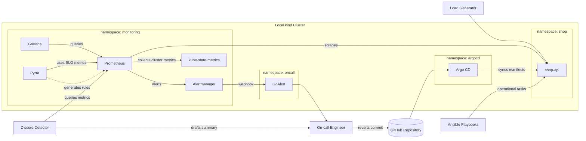

# 00 — Scope and Architecture

## 1. Purpose

This document defines the scope, architecture, and tools for the CloudNova SRE project. Documents 01–06 describe the implementation of each SRE capability.

## 2. Project Scenario

CloudNova Systems needs a consistent way to measure and improve application reliability.

This project builds a small SRE operating model around one Python HTTP application, `shop-api`, running on a local Kubernetes `kind` cluster.

The application exposes a checkout operation and supports controlled failure scenarios so reliability, monitoring, incident response, and recovery can be tested without real customer traffic.

## 3. Scope

### In Scope

- One Python application (`shop-api`) running on a local `kind` cluster.
- `POST /checkout`, `/health`, and `/metrics` endpoints.
- Controlled fault injection for errors, latency, crashes, and simulated dependency failures.
- A load generator for normal traffic and failure scenarios.
- SLIs, SLOs, Error Budgets, and release policies.
- Prometheus, Grafana, and Pyrra for monitoring and SLO tracking.
- Alertmanager and GoAlert for alert routing and on-call notifications.
- Incident procedures, runbooks, and a simulated incident with a postmortem.
- Ansible playbooks for health checks, restarts, and configuration validation.
- GitHub and Argo CD for GitOps synchronization and rollback.
- A lightweight Z-score detector and incident-summary drafts.
- Governance through pull requests, templates, and operational records.

### Out of Scope

- Multiple application services or a microservices architecture.
- A real frontend or a separate backend service.
- A real database or payment integration.
- Production-grade infrastructure, high availability, or cloud deployment.
- Machine-learning models beyond a statistical Z-score check.
- Real customer traffic.
- Reusing code or configuration from earlier repository modules.

## 4. Target Architecture

## 5. Components

| Component | Role |
|---|---|
| `shop-api` | Python HTTP application and source of application metrics |
| Load Generator | Generates normal traffic and controlled failure scenarios |
| Prometheus | Collects and evaluates metrics |
| Grafana | Displays application and Kubernetes health |
| Pyrra | Defines SLOs and tracks Error Budget consumption |
| Alertmanager | Groups and routes alerts |
| kube-state-metrics | Exposes Kubernetes object and Pod state metrics |
| GoAlert | Handles on-call schedules and escalation |
| Ansible | Runs operational checks and recovery tasks |
| GitHub and Argo CD | Manage version-controlled configuration and GitOps synchronization |
| Z-score Detector | Detects metric anomalies and drafts incident summaries |

Container resource metrics are collected from Kubelet/cAdvisor.

## 6. SRE Capability Map

| Area | Capability | Main Tools |
|---|---|---|
| 4.1 | Reliability Measurement and SLOs | Pyrra, Prometheus |
| 4.2 | Observability, Dashboards, and Alerting | Prometheus, Grafana, Alertmanager |
| 4.3 | Incident Management and On-call | GoAlert, runbooks, postmortems |
| 4.4 | Toil Reduction | Ansible, runbooks |
| 4.5 | GitOps Recovery and AI | GitHub, Argo CD, Python |
| 4.6 | Governance and Continuous Improvement | GitHub PRs, templates, operational records |

## 7. Design Principles

1. Keep the implementation limited to the defined scope.
2. Store configurations and operational documentation in version control.
3. Alert on user impact and actionable symptoms.
4. Keep human approval for critical recovery decisions.
5. Mark capabilities as Implemented, Configured, Design only, or Planned based on verified evidence.

## 8. Limitations

- The project runs on a single local `kind` cluster.
- Traffic is synthetic and does not represent real customer behavior.
- Simulated dependency failures do not represent a real external database or payment system.
- Integrations remain unverified until tested.
- CloudNova Systems is a fictional scenario.
