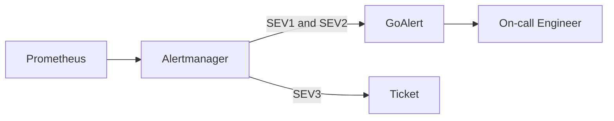

# 02 — Observability, Dashboards, and Alerting

**Area:** 4.2 — Observability, Dashboards, and Alerting  
**Status:** Design only

## 1. Purpose

This document defines how `shop-api` is monitored, how reliability data is displayed, and how alerts reach the on-call engineer.

SLI and SLO definitions are maintained in document 01.

## 2. Metrics Collection

Prometheus will collect application and Kubernetes metrics.

| Source | Metrics | Purpose |
|---|---|---|
| `shop-api` | Request count, duration, HTTP status | Measure checkout reliability |
| Kubernetes | Pod status, restarts, ready replicas | Monitor workload health |
| Kubelet/cAdvisor | Container CPU and memory | Monitor resource usage |

- Application metrics are exposed through `/metrics`.
- `kube-state-metrics` provides Kubernetes object and Pod state metrics.
- Kubelet/cAdvisor provides container resource metrics.

## 3. Grafana Dashboard

One dashboard, **Service Health**, will display the health of `shop-api`.

The dashboard configuration will be stored in the repository.

| Panel | Purpose | Draft PromQL |
|---|---|---|
| Request rate | Checkout traffic | `sum(rate(http_requests_total{endpoint="/checkout"}[5m]))` |
| Error rate | Share of failed requests | `sum(rate(http_requests_total{endpoint="/checkout",status=~"5..\|408\|429"}[5m])) / sum(rate(http_requests_total{endpoint="/checkout"}[5m]))` |
| Availability | Share of successful requests | `1 - (sum(rate(http_requests_total{endpoint="/checkout",status=~"5..\|408\|429"}[5m])) / sum(rate(http_requests_total{endpoint="/checkout"}[5m])))` |
| p95 latency | 95th percentile request duration | `histogram_quantile(0.95, sum by (le) (rate(http_request_duration_seconds_bucket{endpoint="/checkout"}[5m])))` |
| Requests within 300 ms | Latency SLI | `sum(rate(http_request_duration_seconds_bucket{endpoint="/checkout",le="0.3"}[5m])) / sum(rate(http_request_duration_seconds_count{endpoint="/checkout"}[5m]))` |
| SLO and Error Budget | SLO compliance and remaining budget | Pyrra-generated metrics |
| Pod health | Restarts and ready replicas | Kubernetes metrics; exact queries depend on deployed metric labels |

The error-rate query uses the failure criteria from document 01: HTTP 5xx, 408, and 429.

When there is no checkout traffic, the dashboard must show no data rather than a misleading availability or error-rate value.

### Dashboard Sections

1. **SLO Status:** Availability, latency, and Error Budget.
2. **Application Performance:** Request rate, error rate, and latency.
3. **Kubernetes Health:** Pod status, restarts, and resource usage.

## 4. Alerting

Alerts should represent actionable application or reliability problems.

- Prioritize checkout failures and latency degradation.
- Include dashboard and runbook links.
- Group related alerts to reduce notification noise.
- Use severity levels to control escalation.

### Burn Rate Alerts

Each burn-rate alert uses a long evaluation window and a short confirmation window.

| Alert | Burn Rate | Long Window | Short Window | Severity |
|---|---:|---|---|---|
| Fast burn | 14.4x | 1 hour | 5 minutes | SEV1 |
| Slow burn | 6x | 6 hours | 30 minutes | SEV2 |
| Budget trend | 3x | 1 day | 2 hours | SEV3 |

The same approach applies to the latency SLO.

Pyrra is expected to generate the related Prometheus rules. Exact generated rules must be verified during implementation.

### Application and Pod Alerts

| Alert | Condition | Severity |
|---|---|---|
| Service down | `shop-api` Prometheus target is unavailable for 2 minutes or disappears | SEV1 |
| Crash looping | A `shop-api` container remains in `CrashLoopBackOff` for 5 minutes | SEV3 |

Exact PromQL expressions and metric labels will be confirmed against the deployed monitoring stack.

## 5. Severity Levels

| Level | Condition | Response |
|---|---|---|
| SEV1 | `shop-api` is unavailable or checkout is failing badly | Page the on-call engineer immediately |
| SEV2 | Checkout is degraded and consuming the Error Budget quickly | Page the on-call engineer |
| SEV3 | Minor issue or early warning | Create a ticket for working-hours follow-up |

These severity levels are also used by the incident process in document 03.

## 6. Alert Routing

### Noise Reduction

| Technique | Purpose |
|---|---|
| Two-window burn rate | Confirms sustained and ongoing problems |
| `for` duration | Prevents alerts from firing on brief spikes |
| Alert grouping | Combines related alerts |
| Inhibition | Suppresses lower-severity alerts when a related SEV1 is active |
| Severity-based routing | Pages only for SEV1 and SEV2 |

The Alertmanager-to-GoAlert integration and SEV3 ticket destination must be tested during implementation.

## 7. Incident Dashboard Workflow

1. Open the dashboard linked in the alert.
2. Check SLO status and Error Budget.
3. Review request rate, error rate, and latency.
4. Check Pod status, restarts, and resource usage.
5. Follow the relevant runbook.

## 8. Open Items

- Verify application metrics and PromQL queries.
- Confirm Kubernetes metrics and labels.
- Verify the dashboard panels and no-traffic behavior.
- Validate Pyrra-generated alert rules.
- Test Alertmanager-to-GoAlert routing.
- Define the SEV3 ticket destination.
- Test alerts using controlled traffic and failure scenarios.
