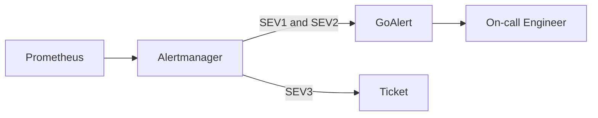

# 02 — Observability, Dashboards, and Alerting

**Area:** 4.2 — Observability, Dashboards, and Alerting  
**Status:** Design only

## 1. Purpose

This document defines how the SRE project monitors its application, visualizes reliability, detects problems, and routes alerts to the appropriate person.

The project uses one application, `shop-api`, running in a local Kubernetes cluster.

The monitoring design focuses on user-facing request metrics and Kubernetes health. All queries and thresholds are initial designs and will be verified during implementation.

## 2. Monitoring Scope

The project contains one HTTP API application:

| Component | Purpose |
|---|---|
| `shop-api` | Handles checkout requests and exposes application metrics |
| Load Generator | Sends requests to simulate application traffic and failures |
| Prometheus | Collects application and Kubernetes metrics |
| Grafana | Displays metrics through dashboards |
| Pyrra | Tracks SLOs and generates related alerting rules |
| Alertmanager | Groups and routes alerts |
| GoAlert | Notifies the on-call engineer |

The application exposes three endpoints:

| Endpoint | Purpose | Included in SLI? |
|---|---|---|
| `POST /checkout` | Main user-facing operation | Yes |
| `/health` | Application health checks | No |
| `/metrics` | Prometheus metrics endpoint | No |

Only `/checkout` is included in the user-facing reliability measurements.

## 3. Metrics Collection

Prometheus collects two main categories of metrics.

| Source | Metrics | Purpose |
|---|---|---|
| `shop-api` | Request count, request duration, HTTP status | Measure user experience and SLIs |
| Kubernetes | Pod status, restarts, ready replicas, CPU, memory | Investigate application and container health |

Kubernetes metrics are expected from:

- `kube-state-metrics` for pod status, container restarts, and replica information.
- Kubelet / cAdvisor for container CPU and memory usage.

Application metrics are exposed through the `/metrics` endpoint.

The required application metrics are defined in document 01.

## 4. Grafana Dashboard

One Grafana dashboard, **Service Health**, will display the health and reliability of `shop-api`.

The dashboard configuration will be stored as JSON in the repository.

| Panel | What it shows | Draft PromQL |
|---|---|---|
| Request rate | Checkout traffic | `sum(rate(http_requests_total{endpoint="/checkout"}[5m]))` |
| Error rate | Share of failed requests | `sum(rate(http_requests_total{endpoint="/checkout",status=~"5..\|408\|429"}[5m])) / sum(rate(http_requests_total{endpoint="/checkout"}[5m]))` |
| Availability | Share of successful requests | `1 - (sum(rate(http_requests_total{endpoint="/checkout",status=~"5..\|408\|429"}[5m])) / sum(rate(http_requests_total{endpoint="/checkout"}[5m])))` |
| Latency (p95) | 95th percentile request duration | `histogram_quantile(0.95, sum by (le) (rate(http_request_duration_seconds_bucket{endpoint="/checkout"}[5m])))` |
| Requests within 300 ms | Latency SLI | `sum(rate(http_request_duration_seconds_bucket{endpoint="/checkout",le="0.3"}[5m])) / sum(rate(http_request_duration_seconds_count{endpoint="/checkout"}[5m]))` |
| SLO compliance and budget | Current SLI and remaining Error Budget | Pyrra-generated metrics (names to be verified) |
| Pod health | Container restarts and ready replicas | `increase(kube_pod_container_status_restarts_total{namespace="shop"}[1h])` |

The error-rate query follows the failure criteria defined in document 01:

- HTTP 5xx responses.
- HTTP 408 responses.
- HTTP 429 responses.

Availability is derived from the error rate.

Queries will be configured to handle periods with no traffic so that missing data is not displayed as a misleading reliability value.

### Dashboard Layout

The dashboard will have three sections:

1. **SLO Status:** Availability, latency, and remaining Error Budget.
2. **Application Performance:** Request rate, error rate, and latency.
3. **Kubernetes Health:** Pod status, restarts, and resource usage.

This layout helps the engineer identify user impact before investigating the application's Kubernetes environment.

## 5. Alerting Principles

1. **Alert on user impact.** Prioritize failing or slow checkout requests over infrastructure metrics alone.
2. **Every page needs an action.** Alerts should require a clear human response.
3. **Link alerts to useful information.** Each alert should include a dashboard and relevant runbook link.
4. **Reduce unnecessary notifications.** Prefer a small number of actionable alerts.

## 6. Burn Rate Alerts

Burn rate alerts detect when `shop-api` consumes its Error Budget faster than expected (see document 01).

Each alert evaluates a long window and a short window together:

- The long window detects sustained reliability problems.
- The short window confirms that the problem is still happening.

| Alert | Burn Rate | Long Window | Short Window | Severity |
|---|---:|---|---|---|
| Fast burn | 14.4x | 1 hour | 5 minutes | SEV1 |
| Slow burn | 6x | 6 hours | 30 minutes | SEV2 |
| Budget trend | 3x | 1 day | 2 hours | SEV3 |

The same approach applies to the latency SLO.

Pyrra is expected to generate the Prometheus recording and alerting rules from the SLO definitions. The exact generated rules and thresholds will be verified during implementation.

## 7. Application and Pod Alerts

Two additional alerts cover application availability and Kubernetes container health.

| Alert | Condition | Severity |
|---|---|---|
| Service down | The expected `shop-api` Prometheus target is unavailable for 2 minutes or disappears | SEV1 |
| Crash looping | A `shop-api` container remains in `CrashLoopBackOff` for 5 minutes | SEV3 (ticket) |

The exact PromQL expressions and metric labels will be confirmed against the deployed monitoring stack.

## 8. Severity Levels

The same severity levels are used for alerts and incidents (document 03).

| Level | Meaning | Response |
|---|---|---|
| SEV1 | `shop-api` is unavailable or checkout is failing badly | Page the on-call engineer immediately |
| SEV2 | Checkout is degraded and consuming its Error Budget quickly | Page the on-call engineer |
| SEV3 | Minor issue or early warning | Create a ticket for working-hours follow-up |

## 9. Alert Routing and Noise Reduction

| Technique | How it reduces noise |
|---|---|
| Two-window burn rate | Reduces alerts caused by short-lived spikes |
| `for` duration | Requires a condition to persist before firing |
| Alert grouping | Combines related alerts into fewer notifications |
| Inhibition | An active SEV1 suppresses lower-severity alerts for the same application |
| Severity-based routing | Only SEV1 and SEV2 notifications page the on-call engineer |

The Alertmanager-to-GoAlert integration and the SEV3 ticket destination will be verified during implementation.

## 10. Using the Dashboard During an Incident

1. An alert arrives with a dashboard link.
2. Open the Service Health dashboard and check the SLO panels.
3. Compare request rate, error rate, and latency to understand the impact.
4. Check pod status, restarts, and resource usage.
5. Follow the runbook linked in the alert.

## 11. Open Items

- Confirm application metric names and label values.
- Verify error-rate and availability queries against actual HTTP responses.
- Verify the 300 ms histogram bucket and latency calculation.
- Confirm Kubernetes metric availability and labels.
- Verify the Pyrra metrics and generated alerting rules.
- Test the Alertmanager-to-GoAlert integration.
- Decide where SEV3 tickets will be created.
- Validate alert behavior using controlled traffic and failure scenarios.
