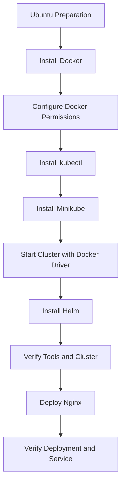

# Lab 01: SRE Lab Environment Setup

## Objective

Prepare an Ubuntu machine as a local SRE lab environment by installing and configuring the tools required for containerization and Kubernetes-based exercises.

The environment will be verified by deploying a sample Nginx application to a local Kubernetes cluster.

## 1. Lab Overview

This lab covers the installation and verification of four essential tools:

| Tool | Purpose |
|---|---|
| Docker | Runs containers and provides the container driver for Minikube. |
| kubectl | Command-line tool for interacting with Kubernetes clusters. |
| Minikube | Creates and manages a local Kubernetes cluster. |
| Helm | Kubernetes package manager used to install and manage applications through charts. |

### Environment Workflow



## 2. Prepare the Ubuntu System

Start by updating the package list and installing the required base tools.

This prepares Ubuntu to download packages securely, manage certificates, and access external installation repositories.

The preparation stage includes:

- Updating the package index.
- Installing required system utilities.
- Preparing certificate and repository-management dependencies.

## 3. Install and Configure Docker

Docker is required to run containers on Ubuntu and will also be used as the driver for the local Minikube cluster.

### Installation Workflow

1. Remove older or conflicting container packages.
2. Add Docker's official GPG key.
3. Configure Docker's official package repository.
4. Update the package index.
5. Install Docker Engine and the required components and plugins.
6. Start the Docker service.
7. Enable Docker to start automatically at system boot.
8. Verify that the Docker service is running.

### Configure Docker Permissions

By default, Docker commands may require administrator privileges.

Add the current user to the Docker group to run Docker commands without using `sudo` each time.

After changing group membership, refresh the shell session so the updated permissions take effect.

### Verify Docker

Check the installed version:

```bash
docker --version
```

Check the Docker service:

```bash
sudo systemctl status docker
```

Run the Docker test container:

```bash
docker run hello-world
```

A successful test displays:

```text
Hello from Docker!
```

This verifies that Docker is installed and can run a container.

## 4. Install kubectl

`kubectl` is the command-line tool used to communicate with Kubernetes clusters.

It allows engineers to:

- Create and manage deployments.
- Inspect pods.
- Manage Kubernetes services.
- Check cluster resources.

Install kubectl and verify the client version:

```bash
kubectl version --client
```

At this stage, kubectl is installed but is not necessarily connected to a running Kubernetes cluster. Minikube will provide that cluster in the next step.

## 5. Install Minikube

Minikube provides a local Kubernetes cluster on a single machine.

It is useful for learning, testing, and practicing Kubernetes without requiring a cloud-based cluster.

Install Minikube, then start the local cluster using Docker as its driver:

```bash
minikube start --driver=docker
```

Docker provides the container environment in which the local Minikube cluster runs.

### Verify the Cluster

Check Minikube status:

```bash
minikube status
```

Check Kubernetes nodes:

```bash
kubectl get nodes
```

Expected result:

- A node named `minikube` should appear.
- Its status should be `Ready`.

This confirms that the local Kubernetes cluster is running and kubectl can communicate with it.

## 6. Install Helm

Helm is a package manager for Kubernetes.

It simplifies application installation, management, and upgrades through reusable packages called **charts**.

In SRE and DevOps workflows, Helm helps teams deploy Kubernetes applications more consistently.

Install Helm and verify the installation:

```bash
helm version
```

Helm is now available for future Kubernetes deployment exercises.

## 7. Deploy a Test Application

After installing the tools, deploy a sample Nginx application to verify that the environment works end-to-end.

Nginx is a lightweight web server commonly used for container and Kubernetes testing.

### 7.1 Create an Nginx Deployment

```bash
kubectl create deployment nginx --image=nginx
```

This creates a Kubernetes Deployment named `nginx` using the Nginx container image.

### 7.2 Expose the Deployment

Expose the application through a NodePort service:

```bash
kubectl expose deployment nginx --type=NodePort --port=80
```

The Service provides a way to access the application through the Minikube environment.

### 7.3 Verify Kubernetes Resources

Check the deployment:

```bash
kubectl get deployments
```

Check the pods:

```bash
kubectl get pods
```

Check the services:

```bash
kubectl get services
```

The expected verification results are:

- The Nginx deployment appears in the deployment list.
- Its pod reaches the `Running` state.
- The service appears with the `NodePort` type.

To obtain the Minikube access URL:

```bash
minikube service nginx --url
```

Use the returned URL to access the test application.

## 8. Environment Verification Checklist

| Component | Verification | Expected Result |
|---|---|---|
| Docker | `docker --version` | Docker version displayed |
| Docker Service | `sudo systemctl status docker` | Active and running |
| Docker Test | `docker run hello-world` | Hello from Docker |
| kubectl | `kubectl version --client` | Client version displayed |
| Minikube | `minikube status` | Cluster components running |
| Kubernetes Node | `kubectl get nodes` | Minikube node is Ready |
| Helm | `helm version` | Helm version displayed |
| Nginx Deployment | `kubectl get deployments` | Nginx deployment listed |
| Nginx Pod | `kubectl get pods` | Pod reaches Running |
| Nginx Service | `kubectl get services` | NodePort service listed |

## 9. Lab Outcome

The Ubuntu machine is prepared with the main tools required for the SRE lab environment:

- Docker installed and configured.
- kubectl installed and ready to communicate with Kubernetes.
- Minikube running a local Kubernetes cluster using Docker as its driver.
- Helm installed and ready for Kubernetes application management.
- Nginx successfully deployed and exposed through a NodePort service.

This environment provides the foundation for future exercises involving:

- Containerized applications.
- Kubernetes workloads.
- Service exposure.
- Helm-based deployments.
- Monitoring and observability.
- Reliability testing.

**Key Takeaway:** A working SRE lab environment should not only have its tools installed; it should also be verified through a real application deployment.
