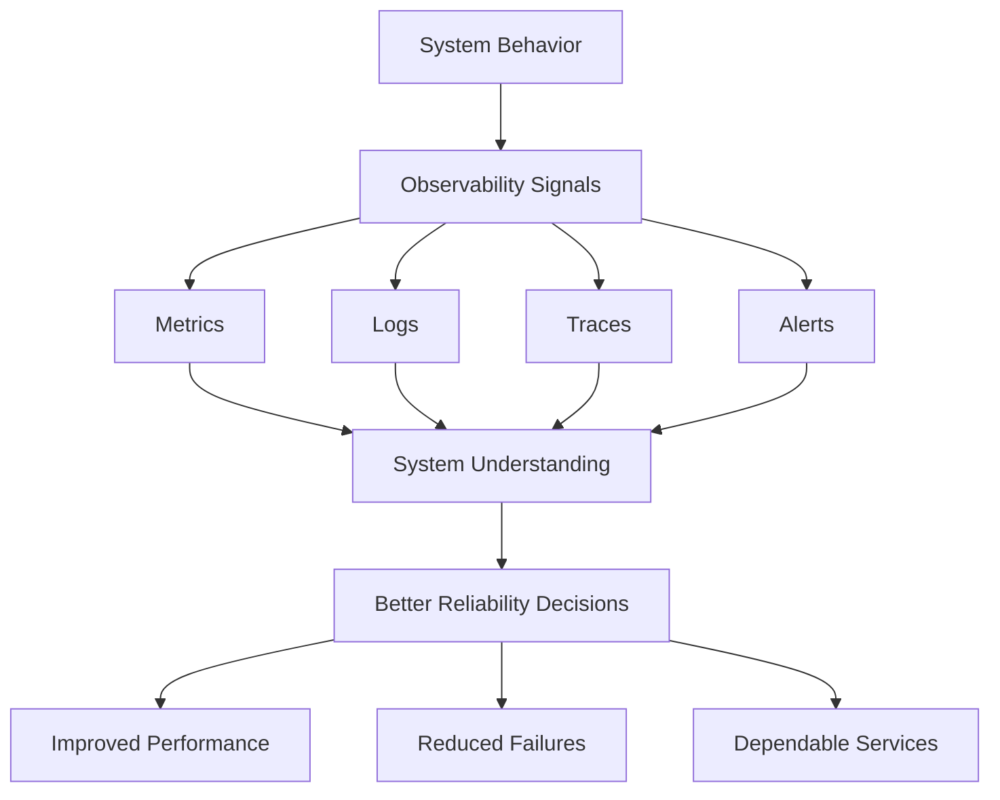

# Observability Fundamentals for Reliable Systems

## Overview

Observability helps engineering teams understand system behavior by providing visibility into what is happening inside their systems.

It transforms raw system data into actionable understanding, allowing SRE teams to detect issues early, investigate root causes, and make informed reliability decisions.

The core idea is:

> You can't fix what you can't see.

## 1. What Is Observability?

Observability is the ability to understand a system's internal behavior through the data it produces.

It provides visibility into system activity across services and helps teams understand how different components behave and interact.

For example, an application dashboard may display:

- Requests per second.
- Error rate.
- Latency.
- Availability.
- CPU and memory utilization.
- Application logs.
- Distributed traces across services.

Together, these signals help teams understand the overall health and behavior of a system.

### Four Dimensions of Observability

| Dimension | Key Question |
|---|---|
| Performance | How fast is the system? |
| Failures | What is breaking? |
| Dependencies | How are services affecting each other? |
| User Impact | Are real users experiencing problems? |

Without observability, teams may react only to visible symptoms. With observability, they gain deeper insight into system behavior and can identify problems before their impact escalates.

## 2. Why Observability Matters

Observability processes system signals and turns them into three important capabilities.

### 2.1 Detect Issues Early

Observability helps teams identify anomalies and emerging problems before they cause greater impact.

This allows engineers to investigate and respond proactively instead of waiting for users to report issues.

### 2.2 Understand Root Causes

When a failure occurs, observability provides context to investigate:

- Which component failed?
- When did the issue happen?
- Under what conditions did it occur?
- How did the failure affect other services?

The goal is to understand why something failed, not just identify what failed.

### 2.3 Respond with Confidence

Reliable and clear system data helps engineers make faster, evidence-based decisions during incidents.

It reduces guesswork and supports more effective incident response.

**Key Idea:** Observability turns signals into understanding.

## 3. The Four Observability Signals

Observability relies on four complementary signals: metrics, logs, traces, and alerts.

No single signal provides the complete picture of system behavior.

### 3.1 Metrics

Metrics are numerical measurements that describe system behavior and performance over time.

Examples include:

- CPU utilization.
- Memory utilization.
- Requests per second.
- Error rate.
- Request latency.
- Service availability.

Metrics help teams identify trends, anomalies, and performance degradation.

**Main purpose:** Show what is happening in the system.

### 3.2 Logs

Logs are timestamped records of events generated by applications and infrastructure.

They provide details about what happened during system execution.

Logs help engineers investigate errors and understand the sequence of events surrounding an issue.

**Main purpose:** Explain what happened.

### 3.3 Traces

Traces represent the journey of a request as it travels across different services in a distributed system.

For example, a request may pass through:

1. User Service.
2. Order Service.
3. Payment Service.

Tracing helps engineers understand the request flow, identify dependencies, and locate where time is spent or failures occur.

**Main purpose:** Show where a request traveled and where delays or failures occurred.

### 3.4 Alerts

Alerts are notifications triggered when system signals cross defined thresholds or deviate from expected behavior.

They help ensure that the appropriate people are informed when intervention may be required.

**Main purpose:** Notify teams when action is needed.

### Signal Comparison

| Signal | Main Question | Example |
|---|---|---|
| Metrics | What is happening? | CPU usage increased |
| Logs | What happened? | Database connection failed |
| Traces | Where did it happen? | Payment Service caused a delay |
| Alerts | When should we act? | High error rate notification |

## 4. Observability and System Reliability

The value of observability is not limited to collecting data or displaying dashboards. Its real value comes from improving the decisions teams make.

### Without Observability

Teams may face:

- Disconnected dashboards.
- Scattered data that is difficult to correlate.
- Manual checks that do not scale.
- Unclear user impact during failures.

As a result, engineers may spend more time understanding what is happening than resolving the actual issue.

### With Observability

Observability provides unified visibility into metrics, logs, traces, and alerts.

This supports:

| Outcome | How Observability Helps |
|---|---|
| Better Reliability Decisions | Decisions are based on real system data rather than assumptions. |
| Improved Performance | Bottlenecks become visible before they develop into outages. |
| Reduced Failures | Issues can be detected and addressed earlier. |
| Dependable Services | Teams can maintain reliability continuously instead of only reacting to incidents. |

## 5. The Observability-to-Reliability Flow

The overall logic is:

**Clear Visibility → Smarter Decisions → Reliable Systems**

## Key Takeaways

- Observability provides visibility into internal system behavior.
- It helps teams understand performance, failures, dependencies, and user impact.
- Its main capabilities are early issue detection, root-cause investigation, and confident response.
- Metrics, logs, traces, and alerts are complementary signals.
- Observability supports better reliability decisions, improved performance, fewer failures, and dependable services.
- The goal is not simply to collect more data, but to turn system signals into actionable understanding.

## Source

- Module 02 — Observability Fundamentals for Reliable Systems (Course Video)